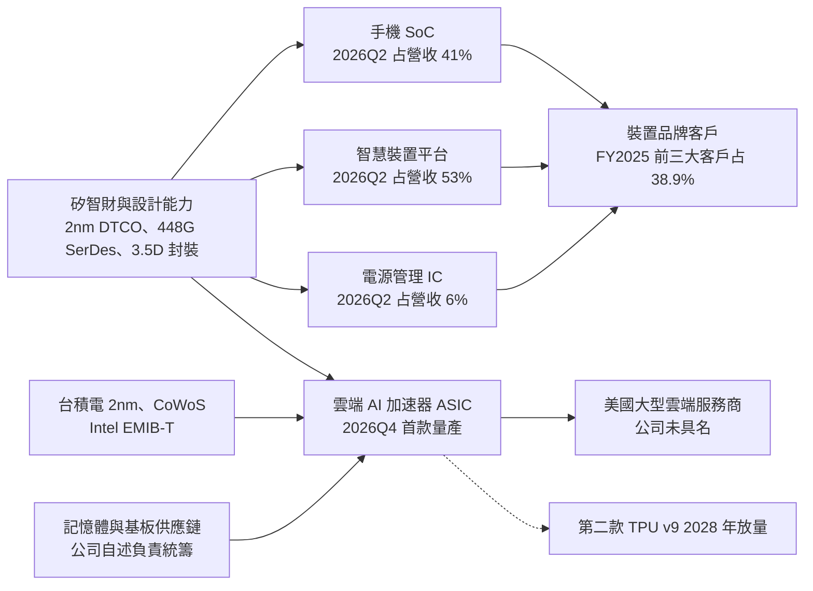

# 聯發科技股份有限公司（TWSE: 2454）CFA 等級投資研究報告

## 執行摘要

1. **聯發科打入 Google TPU 供應鏈，是 Broadcom 之外的第二家設計夥伴。** 聯發科負責 TPU 8i（推論晶片）的高速傳輸介面（SerDes）與先進封裝整合，晶片由台積電 3 奈米生產、CoWoS 封裝，第四季量產，今年貢獻營收逾 20 億美元；公司未點名客戶，以上為供應鏈報導。
2. **第三季營收 1,681 億元，創單季新高，比公司指引上緣高 5%。** 營收年增 18%，主因是 9 月發表的天璣 9600 旗艦晶片（台積電 2 奈米）上市前，手機品牌提前備貨。
3. **NVIDIA 認購聯發科 35 億美元可轉債，雙方合作開發 PC 晶片。** 包含 PC 晶片的智慧裝置平台第二季營收約 807 億元（占營收 53%）、年增 26%，已取代手機成為最大產品群。
4. **主要風險在手機衰退與 AI 晶片訂單分配。** 記憶體漲價推高整機成本，使手機業務第二季營收約 609 億元（占營收 40%）、年減 20%；Google 若把更多世代交給 Broadcom，或資料中心毛利率偏低，2028 年獲利就會不如市場預期。
5. **評級 SELL，12 個月目標價 3,800 元，含股利預期報酬 −18%。** 我們估 2028 年 EPS 205 元，比共識 265 元低 23%，差距來自資料中心假設：我們用 2027 年資料中心營收 140 億美元（管理層指引 120 億至 160 億的中點）、毛利率 40%；現價隱含約 181 億美元。本益比給 20 倍，與聯發科 2021 至 2025 年中位數 19 至 20 倍相當，高於 Broadcom 18.6 倍、台積電 17.9 倍。下一個觀察點是 10 月底法說會，看 2027 年資料中心營收指引能否上修到 180 億美元以上。

<!-- html:skip -->
（前一版摘要，HTML 閱讀版不顯示）

**我們認為聯發科切入資料中心 AI 客製晶片（ASIC）的轉型會成功，但現價已提前反映 2028 年的成功，風險報酬不對稱，評級 SELL。**

- **第三季營收創單季新高，超出公司指引上緣 5%。** 營收 1,681 億元、年增 18%；9 月發表的天璣 9600 Pro（台積電 2 奈米）與 9600M 旗艦手機晶片帶動備貨。

- **AI 客製晶片第四季量產，市場指為 Google TPU 第二家設計夥伴。** 聯發科替美國大型雲端服務供應商（CSP）設計 AI 加速晶片（ASIC，依客戶需求客製的專用晶片）；公司未點名客戶，市場普遍認為是 Google TPU，與 Broadcom 並列供應。首款今年貢獻逾 20 億美元；法人估 2027 年出貨 320 萬至 350 萬顆，管理層目標 2027 年資料中心營收 120 億至 160 億美元。

- **NVIDIA 認購 35 億美元可轉債，PC 晶片合作同步擴大。** 智慧裝置平台年增 26%，產品包含與 NVIDIA 合作的 RTX Spark PC 晶片；手機業務年減 20%，記憶體漲價壓抑換機，仍是拖累。

- **價格已反映 2028 年的成功，評級 SELL。** 現價為共識未來一年 EPS 的 20 倍；我們預估的 2028 年 EPS 比共識低 23%，12 個月目標價 3,800 元，含股利預期報酬 −18%。關鍵變數是資料中心毛利率，公司尚未揭露。前版目標價 2,095 元，本版因資料中心營收與毛利率假設調高而上調。
<!-- /html:skip -->

<!-- html:skip -->
（前一版摘要要點，HTML 閱讀版不顯示）

- **資料中心 AI 客製晶片打開第二條成長曲線。** 聯發科替美國大型雲端服務供應商（CSP）設計 AI 加速晶片（ASIC，依客戶需求客製的專用晶片）；客戶公司未具名，市場普遍指為 Google 的 TPU 專案。首款於 2026 年第四季量產；管理層指引 2027 年資料中心營收 120 億至 160 億美元，約為 2025 年全公司營收的六到八成。我們的 Base 取中點 140 億美元。

- **手機業務衰退，成長要靠 AI 晶片。** 手機占營收四成、年減兩成，記憶體漲價壓抑換機需求；智慧裝置平台年增兩成多，仍不足以抵銷手機衰退。我們假設手機、智慧裝置等既有業務 2027 年僅成長 2%。

- **獲利回升取決於一個未揭露的數字。** 營業利益率已由 23% 降到 15%；ASIC 放量後回到 23% 的前提是資料中心毛利率約 40%，公司迄今未單獨揭露。

- **估值已用共識 2028 年盈餘定價。** 現價等於共識未來一年 EPS 的 20 倍；我們預估的 2028 年 EPS 比共識低 23%，同樣給 20 倍，12 個月目標價 3,800 元，含股利預期報酬 −18%。
<!-- /html:skip -->

<!-- html:skip -->
**和上一版比。** 9/19 版 12 個月目標價 2,095 元，本版上調到 3,800 元，原因是資料中心營收與毛利率的假設調高（依 7 月法說會的毛利率說法與管理層指引中點）；評級維持 SELL。
<!-- /html:skip -->


| 項目 | 數值 |
|---|---:|
| 市值 | NT$7.49 兆 |
| 近四季本益比 | 77 倍 |
| 2027 共識本益比 | 33 倍 |
| 2027E EPS | **143 元**（共識 141） |
| 2028E EPS | **205 元**（共識 265） |
| 2026Q2 毛利率 | 46.2% |
| 2026Q2 營益率 | 15.0% |
| 資料中心目標 | 2027 年 US$12–16bn |
| 本報告假設 | 2027 年資料中心 US$14bn、毛利率 40% |
| 目標本益比 | 20 倍 |
| 現金殖利率 | 1.1% |
| 下個催化劑 | 10 月底 Q3 法說會 |

資料來源：TWSE、公開資訊觀測站、聯發科 2026Q2 法說會、ToAlpha 共識；本研究計算。


<!-- html:skip -->
（完整研究內容，HTML 閱讀版不顯示）

**研究基準日 2026-10-08（週四，最近已完成交易日；2026-10-09 為國慶補假休市，派工日 2026-10-10 為週六）；評級：SELL／Underperform（評級待 issue 40 估值方法修正）；基準日收盤價 TWD 4,690.00；12 個月 Base 目標價 TWD 3,800；36 個月 Base 目標價 TWD 4,450。**

聯發科是全球手機 SoC 出貨量第一的 IC 設計公司，正把成長引擎從手機轉向雲端 AI 加速器 ASIC。**2026 年第三季自結合併營收 1,680.57 億元，季增 10.4%、年增 18.3%，超出公司指引上緣 1,598 億元達 82.6 億元，為單季歷史新高；9 月單月營收 553.99 億元，月減 13.7%、年增 2.0%**（[公開資訊觀測站 9 月營收公告](https://mopsov.twse.com.tw/mops/web/t05st01)、[經濟日報](https://money.udn.com/money/story/5612/9804044)）。這個結果驗證了上一版報告（2026-09-19）對「Q3 優於指引」的判斷。毛利率與 EPS 要到 10 月底至 11 月初的財報才揭曉；已公布的最新財報是 2026Q2：營收 1,521.83 億元、毛利率 46.2%、營業利益率 15.0%、EPS 15.28 元，營業利益年減 22.2%。管理層對資料中心的指引維持 2026 年營收逾 20 億美元、2027 年可服務市場（SAM）800 億美元、市占目標 15% 至 20%，隱含 2027 年資料中心營收 120 億至 160 億美元。

股票面的問題集中在一點：**現價 4,690 元已經用共識盈餘定價。** 以 ToAlpha 共識成長率反推，2027 年 EPS 約 141 元、2028 年約 265 元；現價除以 2027 年 10 月到期日的共識 NTM EPS（234.5 元）等於 20.0 倍，正好是本報告 Base 情境採用的到期本益比。換句話說，市場不需要倍數擴張，只需要 2028 年 EPS 達 265 元。本報告 Base 的 2028 年 EPS 為 205 元（2027 年 143 元，與共識 141 元一致），差額來自資料中心營收規模（Base 2027 年 140 億美元、2028 年 240 億美元）與資料中心毛利率 40%。以 Base 盈餘計算，現價隱含 24.5 倍到期本益比，高於 Broadcom（下一財年 18.6 倍）、Qualcomm（17.2 倍）、台積電（17.9 倍）。

主模型為情境 EPS 乘到期本益比：12 個月目標價採 2027 年 10 月的 NTM EPS（四分之一 2027 年加四分之三 2028 年）乘 Bear 15 倍／Base 20 倍／Bull 28 倍，得 1,150／3,800／7,700 元；36 個月 950／4,450／9,700 元。交叉檢查：FCFF DCF 每股 Bear 835／Base 3,318／Bull 5,699 元；12 個月後 SOTP 中性 3,835 元。**最終評級：SELL／Underperform；Base 12 個月預期總報酬 -17.8%（含股利 56 元）；機率加權（25%／50%／25%）12 個月預期總報酬 -11.4%，兩者都低於 SELL 門檻 -10%。** 此評級對到期本益比敏感：本益比每變動 1 倍，Base 目標價變動約 190 元（約 Base 目標價的 5%）；本益比升至 22 倍，Base 預期總報酬約 -10%，位於 SELL 與 HOLD 的邊界。因此本版評級的信心為中等偏低，且全部押在 2028 年盈餘。

| 投資快照 | 判斷 |
|---|---:|
| 現價與市值 | TWD 4,690.00（2026-10-08 收盤）；市值 **7,490.7 十億元**（已發行扣庫藏股）；完全稀釋（含可轉債轉換股）7,618.9 十億元 |
| 最新營收／成長 | 2026Q3 自結營收 **168,057 百萬元**（QoQ +10.4%、YoY +18.3%）；2026 年前三季 469,391 百萬元（YoY +5.3%）；最新已申報財報 2026Q2 營收 152,183 百萬元（YoY +1.2%） |
| 最新全年指引或外部預估 | 管理層：FY2026 美元營收達「高個位數成長」區間上緣、資料中心營收逾 US$2bn；共識（ToAlpha，29 位分析師）FY2026 EPS 成長 +3.8%、FY2027 +106.2%、FY2028 +87.8% |
| 產業核心 KPI | 2027 資料中心 SAM US$80bn、市占目標 15% 至 20%（**管理層估計**）；手機 AP／SoC 出貨量市占 31%（2026Q2，Counterpoint）；全球手機 2026 年出貨預期衰退約 15%（管理層） |
| 毛利率／營業利益率／現金流率 | 2026Q2 毛利率 **46.2%**、營業利益率 **15.0%**；TTM FCF 79,161 百萬元（FCF margin 13.3%）；2026H1 FCF -14,148 百萬元 |
| 現金、債務與淨現金 | 可扣除現金與投資 358.9 十億元（含 2026-09-08 可轉債進帳 123.4，扣 7 月股利 39.3）；有息負債 41.4；形式淨現金 317.4 十億元 |
| Bear／Base／Bull 每股價值 | DCF **835／3,318／5,699 元**；12 個月目標價 1,150／**3,800**／7,700 元 |
| 12 個月 Base 目標價與上／下行 | **TWD 3,800**；價格報酬 -19.0%；含股利 56 元之預期總報酬 **-17.8%**；Bull 上行 +65%、Bear 下行 -74% |
| 36 個月 Base 目標價與上／下行 | **TWD 4,450**；累積價格報酬 -5.1%；含三年股利約 181 元之累積總報酬 -1.3%（年化 -0.4%） |
| 下一個月最重要事件與目前交易行動 | 3Q26 財報與法說會（預估窗口 2026-10-29 至 11-06，公司尚未公告）決定 2027 年資料中心指引與 4Q26 毛利率；現階段行動：已持有者依減碼階梯分批減碼，不新增 |
| 最終評級 | **SELL／Underperform（評級待 issue 40 估值方法修正）** |

資料來源：[TWSE 個股日成交資訊](https://www.twse.com.tw/rwd/zh/afterTrading/STOCK_DAY?date=20261001&stockNo=2454&response=json)（2026-10-08 收盤）、[TWSE OpenAPI t187ap03_L](https://openapi.twse.com.tw/v1/opendata/t187ap03_L)（已發行 1,604,952,613 股）、公開資訊觀測站合併財報（2026Q2）與月營收公告、聯發科 2026Q2 法說會（[Prepared remarks](https://www.mediatek.com/hubfs/MediaTek%20Assets/Pdfs/Quarterly%20Earnings%20Release/2026/Quarterly%20Earnings%20Release-2026Q2/Prepared%20remarks.pdf)）、[ToAlpha](https://toalpha.tw/stock/2454)共識衍生比率；模型為 `model/mediatek_valuation_2026-10-08.py`，本研究計算。

**公司品質與股票報酬分開看。** 公司品質高：研發規模台灣第二、毛利率五年低點仍有 46%、淨現金超過 3,000 億元、股利政策明訂配發 80% 以上且連續 26 年發放，並已在手機以外長出智慧裝置平台（佔營收 53%）與首款量產的資料中心 ASIC。股票的風險報酬偏弱：以 4,690 元買入，Base 情境 12 個月預期總報酬為負，Bull 情境需要 2028 年 EPS 達 300 元以上且市場給 28 倍。公司品質沒有爭議，爭議在價格是否已提前支付 2028 年的盈餘。

### 前兩版區間差異的來源與本版判斷

2026-09-19 claude 版（合理區間 1,750 至 2,650 元）與 2026-09-23 codex 版（3,599 至 4,222 元）相差 59%，原因如下。**結論：差異來自三處，折現率不是其中之一（codex 的 WACC 9.5% 反而高於 claude 的 9.16%）。**

| 差異來源 | 2026-09-19 claude | 2026-09-23 codex | 本版 2026-10-10 | 對每股價值的影響 |
|---|---|---|---|---|
| 區間定義 | SOTP 保守版至樂觀版（現在價值，1,750 至 2,650） | Base DCF 至機率加權 DCF（3,599 至 4,222） | 依論點檔契約：12M Bear 至 Bull（1,150 至 7,700）；另列中央帶 3,300 至 4,300 | 兩版區間本來不可比：一個是 SOTP 內的上下限，一個是同一 DCF 的 Base 與加權值 |
| 資料中心營收與毛利率 | 2027 年 US$10bn、毛利率 35% | 未拆分；以共識 FY27 EPS 141 元、手填 FCFF 路徑代替 | 2027 年 US$14bn、毛利率 40% | 橋接顯示：毛利率 35% 改 40% 加 251 元；營收路徑 US$10bn 改 US$14bn（2028 年 24bn）加 1,164 元 |
| 現金流路徑 | 由損益、資本支出與營運資金推導：2027 年 FCFF 88 十億元、2035 年 237 | 手填：2027 年 220、2035 年 560（無營收與毛利率拆分，2027 年 FCFF 約等於共識淨利 229） | 推導：2027 年 119、2035 年 407 | codex 的 2027 年 FCFF 假設營收成長 69% 的年度幾乎沒有營運資金與資本支出拖累；本版推導的 2027 年 FCFF 只有淨利的 51% |
| 12M 目標價方法 | 0.5 DCF 加 0.3（22 倍乘 2027 年 EPS 108 元）加 0.2 SOTP，得 2,095 | 共識代理 FY27 EPS 141 元乘 30 倍，得 4,200 | 到期 NTM EPS 189 元乘 20 倍，得 3,800 | codex 的 30 倍乘 2027 年 EPS，在 2027 年 10 月已是落後盈餘，等於 codex 自己的 2028 年 EPS 假設 230 元的 18.3 倍 |
| 折現率 | WACC 9.16% | WACC 9.5% | WACC 8.66%（共用資料層 Rf 1.92%、ERP 4.92%，beta 1.40） | 對 claude 版橋接加 144 元，不是兩版差距來源 |

資料來源：`研究報告/2454TW-聯發科/2026-09-19/claude/model/mediatek_valuation_2026-09-18.py` 與 `2026-09-23/codex/model/mediatek_valuation.py`、本版 `model/bridge_vs_prior.py`（以前版模型為起點逐項換入本版假設，輸出 `model/bridge_vs_prior.json`）；本研究計算。

**本版判斷：兩版各錯一半，Base 落在中間偏 codex。** claude 9/19 版的資料中心毛利率 35% 低估：2026-07-31 法說會 Q&A 中財務長被問到第二代專案毛利率時表示，毛利率世代間相近，「與公司平均相比，是我們先前提供的同一指引，會略微稀釋」（原文 slightly diluted compared to the current corporate gross margin）；9/19 版只引用了 4 月底「毛利率視個案而定」的說法。若合併毛利率只是略微稀釋，資料中心毛利率應落在 40% 上下，而不是 35%。共識亦呼應：ToAlpha 顯示 FY2027 毛利率預估較最新季下降 1.9 個百分點，以共識代理的營收組合反推資料中心毛利率約 42%。codex 9/23 版的問題在 DCF 的現金流路徑無法稽核（手填且未拆分營收與毛利率），以及 12 個月目標價用 30 倍乘 2027 年盈餘。本版採用管理層指引區間（120 億至 160 億美元）中點的 2027 年資料中心營收 140 億美元，毛利率 40%，到期本益比 20 倍（錨定 Broadcom 18.6 倍、台積電 17.9 倍與聯發科自身 2021 至 2025 年約 19 至 20 倍），結果介於兩版之間，12 個月目標價更接近 codex 版。

### 前版論點檢驗

| 前版（2026-09-19 claude）論點或預測 | 截至 2026-10-08 的證據 | 判定 |
|---|---|---|
| 8 至 9 月營收使 Q3 優於指引（9 月高於 54,330 百萬元為偏多門檻） | 9 月 55,399 百萬元；Q3 168,057 百萬元超出上緣 5.2% | 成立 |
| 近四季 EPS 下滑，漲幅來自本益比擴張 | TTM EPS 60.68 元（FY2025 66.16 元）；股價自 4,710 元整理後收 4,690 元，本益比 77.5 倍 | 成立，但價格沒有向前版目標 2,095 元修正 |
| 資料中心毛利率 35%，公司拒絕承諾 | 7/31 Q&A：毛利率「略微稀釋」，營業利益率明顯增益 | 部分被推翻：35% 偏低，改 40% |
| 2027 年資料中心營收 US$10bn（Base） | 管理層指引隱含 12 至 16bn；BofA 預估 US$19bn（9 月）；法人估 2027 年出貨 320 至 350 萬顆 | 被推翻：Base 上調至 14bn |
| SELL，12M Base 2,095 元 | 同樣方向 SELL，Base 上調至 3,800 元 | 評級方向維持，估值大幅上修 |
| F1 資料中心毛利率單獨揭露且 ≥45% | 未揭露 | 未觸發 |
| F2 2027 年指引 ≥US$20bn 或第三個設計導入 | 公司指引未變；第三方預估（BofA US$19bn）不是公司指引 | 未觸發 |
| F3 2026Q4 資料中心營收 ≥US$2.5bn 且毛利率 ≥46% | 4Q26 尚未結束 | 未觸發，待 10 月底 |
| F4 手機平台營收年增轉正 | 2026Q2 手機年減 20%；Q3 起旗艦 2nm 備貨但供應鏈稱 11 月轉弱 | 未觸發 |

資料來源：`研究報告/2454TW-聯發科/2026-09-19/claude/thesis.json` 與 SUMMARY.md、公開資訊觀測站月營收公告、聯發科 2026Q2 法說會逐字稿（[Transcript](https://www.mediatek.com/hubfs/MediaTek%20Assets/Pdfs/Quarterly%20Earnings%20Release/2026/Quarterly%20Earnings%20Release-2026Q2/Transcript.pdf)）、[經濟日報 BofA 與 Bernstein 報導](https://money.udn.com/money/story/5607/9781841)、[工商時報](https://www.ctee.com.tw/news/20260928700336-430201)；本研究判定。
<!-- /html:skip -->

---

## 公司、商業模式與策略定位

**聯發科是純 IC 設計（fabless）公司，把矽智財與系統整合能力賣給裝置品牌與雲端業者，本身不擁有晶圓廠。** 公司 1997 年成立、2001 年於台灣證券交易所掛牌，總部在新竹科學園區；董事長蔡明介、執行長蔡力行、財務長顧大為。單一普通股股別，面額 10 元，無存續 GDR 或 ADR。截至 2026-10-08 已發行 1,604,952,613 股，庫藏股 7,794,085 股（2026-06-30 資料）。

### 營收結構與收入引擎

**智慧裝置平台已取代手機成為最大產品群。** 2026Q2 占營收 53%、年增 26%，主要來自連網、Arm 運算與 PC 晶片等新產品線。資料中心 AI 晶片目前也計入這一群。

**手機營收年減 20%，主因是記憶體漲價。** 手機降到占營收 41%，記憶體漲價推高整機成本，Android 品牌下修出貨；管理層預期今年全球手機出貨衰退約 15%。電源管理 IC 約占 6%，成長來自運算與資料中心。

**四個事業都靠賣晶片賺錢，沒有長期合約。** 雲端 AI 晶片另外先收一筆客製設計費。營收能見度主要靠月營收與每季法說會指引。

<!-- html:skip -->
揭露限制：公司未拆分智慧裝置平台各產品線的貢獻；資料中心 AI 晶片計入智慧裝置平台，尚未單獨揭露其營收與毛利率；公司不公布在手訂單。
<!-- /html:skip -->

| 事業 | 主要產品 | 終端客戶 | 商業模式 | 近況 |
|---|---|---|---|---|
| 手機晶片 | 天璣系列手機處理器（SoC） | 前三大為小米、三星、OPPO（合占出貨約六成），其次 vivo、傳音、榮耀；天璣 9600 旗艦目前傳僅 vivo、OPPO 採用 | 賣晶片給手機品牌，每代新機逐案議價，沒有長期合約 | 2026Q2 年減 20%；今年手機出貨預期衰退約 15%，主因記憶體漲價推高整機成本 |
| 智慧裝置平台 | Wi-Fi 與網通晶片、電視晶片、車用晶片、Arm 架構 PC 晶片 | 網通設備、電視、車廠、PC 品牌（含 NVIDIA RTX Spark PC） | 賣晶片，產品線分散，單一客戶比重低 | 2026Q2 年增 26%，今年唯一的成長來源 |
| 電源管理晶片 | 手機與運算裝置用電源 IC | 手機與運算裝置廠 | 賣晶片，多與處理器搭配出貨 | 占營收約 6%，成長來自運算與資料中心 |
| 雲端 AI 晶片（ASIC） | 替雲端業者客製的 AI 加速晶片 | 美國大型雲端業者（公司未具名，市場傳為 Google） | 先收客製設計費，量產後按出貨量收錢；另替客戶張羅記憶體與基板 | 首款 Google TPU 8i（推論晶片，代號 Zebrafish，台積電 3 奈米）2026Q4 量產、今年營收逾 20 億美元；第二款 TPU v8e／v9 2028 年初量產（款名為供應鏈報導，公司未證實） |

資料來源：聯發科 2026Q2 法說會；手機客戶結構為 Canalys 2024Q3（小米 23%、三星 21%、OPPO 16%），公司不揭露客戶名單；天璣 9600 採用名單為旺得富 2026-06 報導，屬傳聞。公司自述另負責統籌 ASIC 所需的記憶體與基板；若這部分以低毛利計入營收，資料中心營收會變大、毛利率會偏低，這是資料中心毛利率最大的不確定因素。

<!-- html:skip -->
（完整研究內容，HTML 閱讀版不顯示）

### 分部與揭露邊界

**查核財報只有一個報導分部。** 三產品群占比是法說會的自願揭露，只給占比不給金額，且雲端 AI ASIC 計入智慧裝置平台，沒有單獨拆分。

| 產品群 | 2025Q2 | 2025Q3 | 2025Q4 | 2026Q1 | **2026Q2** | 2026Q2 YoY | 2026Q3 指引（QoQ） |
|---|---|---|---|---|---|---|---|
| 手機（Mobile Phone） | 52% | 53% | 59% | 49% | **41%** | -20% | 持平至中個位數下降 |
| 智慧裝置平台（Smart Edge Platforms） | 43% | 42% | 37% | 46% | **53%** | +26% | 中高個位數成長 |
| 電源管理 IC（Power IC） | 6% | 5% | 5% | 5% | **6%** | +6% | 約略持平 |

資料來源：聯發科各季法說會逐字稿（[2026Q2](https://www.mediatek.com/hubfs/MediaTek%20Assets/Pdfs/Quarterly%20Earnings%20Release/2026/Quarterly%20Earnings%20Release-2026Q2/Transcript.pdf)、2026Q1、2025Q4）；占比為管理層自願揭露，四捨五入後合計不必為 100%。限制：2024Q3 至 2025Q1 三季占比本次未查得。

資料中心營收與毛利率在 2026Q2 後仍未單獨揭露，管理層表示能見度提高時才拆分，外界只能依管理層口頭指引建模。

### 收入引擎

| 收入引擎 | 收費機制 | 投資含義 |
|---|---|---|
| 手機 SoC | 按顆計價，逐案與品牌客戶議價，無長約 | 2026Q2 年減 20%；管理層預期 2026 年手機出貨衰退約 15%，原因是記憶體成本推升整機 BOM；9 月發表的天璣 9600 Pro（台積電 2nm）與 9600M（3nm）支撐 Q3 備貨 |
| 智慧裝置平台 | 按顆計價，產品線分散（連網、電視、車用、Arm 運算、NVIDIA RTX Spark PC） | 2026Q2 年增 26%，是 2026 年唯一成長來源；管理層指引 Q3 再成長中高個位數 |
| 電源管理 IC | 按顆計價 | 占 6%，成長來自運算與資料中心 |
| 雲端 AI 加速器 ASIC | 專案 NRE 加量產按顆計價；公司自述另統籌記憶體與基板 | 首款 2026Q4 量產、2026 年營收逾 US$2bn；第二款 2028 年量產；毛利率「略微稀釋」、營業利益率「明顯增益」 |

資料來源：聯發科 2026Q2 法說會 Prepared remarks 與 Q&A；本研究整理。「統籌記憶體與基板」是否計入聯發科營收，公司未說明，這是資料中心毛利率最大的不確定來源（若 HBM 與基板轉單以低毛利計入營收，營收膨脹但毛利率偏低，9/19 版的此項待查證在本版仍未解）。
<!-- /html:skip -->



### 最大成長引擎：Google TPU 客製晶片

**聯發科是 Google TPU 在 Broadcom 之外的第二家設計夥伴，這是公司未來三年最大的成長來源。** 公司只說客戶是「美國大型雲端服務供應商」，從未點名；供應鏈與賣方報導一致指向 Google 的 TPU（Tensor Processing Unit，Google 自研的 AI 加速晶片）。

**聯發科負責高速傳輸介面與先進封裝整合，晶圓由台積電代工。** Broadcom 仍是 Google 的主力夥伴並簽有十年合約，聯發科負責部分世代的設計，核心能力是高速傳輸介面（SerDes）與先進封裝整合。

**管理層目標 2027 年資料中心營收 120 億至 160 億美元。** 管理層估 2027 年可服務市場約 800 億美元、目標市占 15% 至 20%，對應資料中心營收 120 億至 160 億美元，相當於 2025 年全公司營收（約 190 億美元）的六到八成；BofA 預估 2027 年聯發科的 TPU 相關營收可達 190 億美元。

| 世代（報導名稱） | 量產時點 | 製程與封裝 | 聯發科角色與規模 |
|---|---|---|---|
| 第一代：TPU 8i（推論，代號 Zebrafish；早期報導稱 v7e） | 2026Q4 量產（公司法說證實「第四季」），2026Q1 末風險試產 | 台積電 3 奈米（多數報導；少數稱 2 奈米）；台積電 CoWoS 封裝 | 與 Google 共同設計；2026 年營收逾 20 億美元（公司指引），今年出貨約 60 萬顆 |
| 第二代：TPU v8e／v9（報導對應不一） | 2028 年初（公司：第二代按計畫推進） | 台積電先進製程（3 或 2 奈米，報導不一）；CoWoS 與 Intel EMIB-T 雙軌封裝 | 以 336G SerDes 取得 v9 多數訂單（工商時報）；法人估 2027 年出貨 320 萬至 350 萬顆 |
| 第三代：TPU v10（代號 Icefish） | 最快 2028 年 | 2 奈米（400G／448G SerDes 開發中，預計 2027 下半年就緒） | 研發階段；成敗決定能否與 Broadcom 爭取更多世代 |

資料來源：聯發科 2026Q2 法說會；[Google 2026-04-22](https://blog.google/innovation-and-ai/infrastructure-and-cloud/google-cloud/eighth-generation-tpu-agentic-era/)；[TrendForce 2025-12-15](https://www.trendforce.com/news/2025/12/15/news-mediatek-reportedly-secures-google-v7e-v8e-tpu-orders-requests-7-fold-cowos-increase-from-tsmc/)、[TrendForce 2026-08-03](https://www.trendforce.com/news/2026/08/03/news-mediatek-advances-400g-serdes-on-2nm-targeting-google-tpu-v10-and-meta-ai-asic-orders/)（轉述經濟日報、工商時報）；[經濟日報](https://money.udn.com/money/story/5607/9781841)。TPU 8t（訓練）與 8i（推論）兩個名稱為 Google 官方發表；聯發科對應哪一款、代號、製程與量產時點為供應鏈報導，公司未證實。

```timeline
2026Q1 末 | TPU 8i 風險試產 | | 報導
2026Q4 | TPU 8i 量產 | 公司證實第四季量產；款名與 3 奈米為報導 | 證實
2027 | 資料中心營收目標 | 120 億至 160 億美元 | 證實
2027 下半年 | 400G／448G SerDes 就緒 | | 報導
2028 初 | TPU v8e／v9 量產 | CoWoS 與 Intel EMIB-T | 報導
最快 2028 | TPU v10 | 2 奈米 | 報導
```

資料來源：聯發科 2026Q2 法說會（2026Q4 量產、2027 年營收目標）；其餘時點為 TrendForce、經濟日報、工商時報供應鏈報導，公司未證實。

**與台積電的連結是產能，不只是製程。** 晶片在台積電 3 奈米投片，下一代往 2 奈米走；真正的瓶頸在 CoWoS 先進封裝。經濟日報報導，聯發科 2026 年 Google 專案的 CoWoS 配額由約 1 萬片上修到 2 萬片，2027 年要求超過 15 萬片，是 2026 年的 7 倍以上。

**CoWoS 不夠用，聯發科同步採用 Intel EMIB-T 封裝。** 台積電 CoWoS 被 NVIDIA 占去一半以上，聯發科因此加用 Intel EMIB-T（執行長在法說會證實）；UBS 9 月報告指出，台積電另以 CoWoS-L 作為 2028 年 2 奈米 TPU 的第二封裝來源，支撐聯發科全年約 300 萬顆的目標。所以聯發科 2027 年營收能否達標，看的是封裝產能能拿到多少，而不只是 Google 下多少單。


### 資本配置

| 2026 | 動作 | 金額 |
|---|---|---:|
| 2月 | 採購測試與研發設備 | NT$155 億 |
| 7月 | 取得 Arm、Cadence、Synopsys 授權與研發設備 | NT$62 億 |
| 7月 | 董事會通過公司債與海外可轉債額度 | 上限 US$50 億 |
| 9月 | 發行零息可轉債，NVIDIA 認購 US$35 億 | US$39 億 |

資料來源：公開資訊觀測站重大訊息、SGX 可轉債發行通函；NVIDIA 合作內容見 [Notebookcheck](https://www.notebookcheck.net/Nvidia-and-MediaTek-extend-collaboration-to-develop-multiple-generations-of-RTX-Spark-and-DGX-Spark-PC-chips.1384037.0.html)、[Guru3D](https://www.guru3d.com/story/nvidia-invests-billion-in-mediatek-as-partnership-expands-to-future-rtx-pc-chips-and-nvlink-ai/)、[聯合報 GTC Taipei 報導](https://udn.com/news/story/7240/9539496)。

**為 ASIC 量產先籌資金，代價是約 1.7% 的股本稀釋。** 帳上已有約 2,740 億元現金與投資，公司仍發行 39 億美元零息可轉債，代表 ASIC 量產需要的產能預付與備料超出原本的資金規劃，這和上半年存貨增加 313 億元的方向一致。轉換價 4,513.75 元已低於現價，估值以全數轉換計算，股數增加約 1.7%。

**NVIDIA 認購其中 35 億美元，雙方合作從 PC 晶片延伸到多個世代。** 兩家公司在 2026 年 6 月 Computex 宣布，合作開發多個世代的 RTX Spark 與 DGX Spark 晶片，範圍也擴及 AI 基礎設施與車用。合作起點是 DGX Spark 個人 AI 電腦的 GB10 晶片；新一代 RTX Spark（研發代號 N1X）採台積電 3 奈米，聯發科與 NVIDIA 共同設計 20 核心 Arm 架構 CPU，NVIDIA 提供 Blackwell GPU，首批 Windows 筆電今年秋天上市。這筆可轉債是保本加股價選擇權的財務投資，不代表 NVIDIA 認同現在的股價。

**股利政策維持配發稅後淨利 80% 至 85%。** 每半年發放一次，下次決議預計與第三季財報同日公布。

<!-- html:skip -->
（完整研究內容，HTML 閱讀版不顯示）

### 資本配置與策略動作

| 日期 | 事項 | 金額 | 說明 |
|---|---|---|---|
| 2026-02-04 | 取得營業設備 | NT$155 億 | 愛德萬測試、鴻勁精密、台積電、中華精測等 |
| 2026-07-31 | 取得無形資產；取得營業設備案 | NT$33.17 億；NT$28.95 億 | Arm、Cadence、Synopsys 授權；擴充研發設備 |
| 2026-07-31 | 董事會通過普通公司債與海外轉換公司債 | 合計上限 US$50 億 | 2026Q2 法說會稱為「彈性融資預算」，用於供應鏈產能與資料中心擴充 |
| 2026-08-31 訂價，09-08 發行 | 海外第一次無擔保轉換公司債 | US$39 億，零息，5 年期，轉換價 NT$4,513.75 | NVIDIA 認購 US$35 億；固定匯率 31.643；全數轉換新增約 27.34 百萬股 |
| 2026-09-30 | 限制員工權利新股上市 | 1,073,393 股 | 已含在 9 月 TWSE 已發行股數 |

資料來源：公開資訊觀測站重大訊息（[查詢系統](https://mopsov.twse.com.tw/mops/web/t05st01)，代號 2454，發言日 2026-02-04、2026-07-31、2026-08-31、2026-09-03）、[SGX 發行通函](https://links.sgx.com/FileOpen/MediaTek%20Inc.%20-%20Final%20Offering%20Circular%20dated%2031%20August%202026.ashx?App=Prospectus&FileID=70978)；轉換股數為本研究計算。

三點解讀。第一，手上有 2,740 億元現金與投資的公司仍發行 US$39 億零息債，說明預期的產能預付與營運資金需求超過現有現金，對照 2026H1 存貨增加 313 億元，方向一致。第二，NVIDIA 認購的是零息可轉債，經濟實質是保本加股價選擇權，不能解讀為對 4,690 元的背書。第三，轉換價 4,513.75 元低於現價，債券處於價內，本版估值以全數轉換為基準：債務消失、現金留存、股數增加 27.34 百萬股，只計一次。

股利方面，章程目標配發稅後淨利 80% 至 85%，每半年決議一次。FY2021 至 FY2025 每股現金股利 73.00／76.00／55.00／54.00／53.50 元；最近兩次為 2026-01-06 除息 29.00 元與 2026-07-07 除息 24.50 元。下一次（2026 年前半年度）通常與 Q3 財報同日由董事會決議（2025 年為 2025-10-31）。
<!-- /html:skip -->

---

## 市場規模與競爭格局

### AI ASIC 市場：買家是四大 CSP 與 OpenAI、Anthropic，聯發科只打進 Google，Meta 是下一個關鍵

**下單的是自己設計晶片的四大雲端服務業者（CSP）Google、Meta、Amazon、Microsoft，加上 AI 模型公司 OpenAI 與 Anthropic。** 這些公司自己定義晶片規格，再找設計夥伴做實體設計、高速介面與量產。Google 的 TPU 分給 Broadcom 與聯發科；Meta 的 MTIA、OpenAI 的 Jalapeño 與 Anthropic 的晶片由 Broadcom 設計，Anthropic 2027 年將成為 Broadcom 最大客戶；Amazon 的 Trainium 以世芯為主，高通拿下另一條推論晶片；Microsoft 的 Maia 由創意與 Marvell 分做。

| 機構 | 規模（美元） | 範圍 |
|---|---|---|
| Gartner（採用） | 2030 年 2,036 億 | 未說明 |
| 聯發科 | 2027 年 800 億 | 只算加速晶片 |
| Bernstein | 2028 年 2,500–3,000 億 | 含 HBM |
| Marvell | 2030 年 2,350 億 | 含周邊晶片 |

<!-- html:skip -->
（完整版，HTML 閱讀版以上方精簡表放右側欄）

| 機構（發布日） | 規模估計（美元） | 計算範圍 |
|---|---|---|
| Gartner（2026-08-26，本報告採用） | 2025 年 677 億、2030 年 2,036 億 | 公開摘要未說明是否只算 AI、含不含 HBM |
| 聯發科（2026Q2 法說會） | 2027 年 800 億 | 只算 AI 加速晶片，不含資料中心 CPU 與交換器晶片 |
| Bernstein（2026-09-15） | 2026 年 500 至 700 億、2027 年 1,300 至 1,500 億、2028 年 2,500 至 3,000 億 | 含 HBM |
| Marvell（2026-10-06 投資人日） | 2030 年 2,350 億 | 加速晶片加周邊晶片 |
<!-- /html:skip -->

資料來源：[Gartner](https://www.gartner.com/en/documents/8307253)、聯發科 2026Q2 法說會、Bernstein（[智通財經轉述](https://www.webull.com/news/15580774049924096)）、Marvell（[Futurum 整理](https://futurumgroup.com/?p=96506)）。

**市場 2030 年前每年成長約 25%，聯發科只靠 Google 一家，份額 2027 年約 13%、2028 年約 18%。** Base 假設聯發科資料中心營收 2027 年 140 億、2028 年 240 億美元。換成管理層自己的 800 億美元口徑，2027 年等於 17.5%，落在 15% 至 20% 的市占目標內。

**份額要再往上，關鍵是第二個客戶，最可能是 Meta，但尚未證實。** Meta 2026 年 3 月發表 MTIA 300 至 500 四款晶片，公布的設計夥伴仍是 Broadcom，雙方合作延伸到 2029 年。DIGITIMES 2026 年 7 月報導聯發科取得 Google 以外的第二個 ASIC 客戶，業界推測是 Meta（[鉅亨轉述](https://hao.cnyes.com/post/257336)）；摩根士丹利評估聯發科爭取 Meta 專案的勝率約五成，瑞銀估若量產，2028 至 2029 年每年可貢獻 30 億至 40 億美元營收（[經濟日報](https://money.udn.com/money/story/5607/8864894)）。公司沒有點名客戶，Base 未計入 Meta；若成真，2028 年份額可再多約 2 至 3 個百分點。

| 來源 | 2027 年 | 依據 |
|---|---|---|
| 管理層指引 | 120–160 億 | 800 億市場 × 15–20% |
| 本報告 Base | 140 億 | 指引中點 |
| UBS | 180 億 | TPU 營收 |
| 現價隱含 | 181 億 | 反推估值 |
| BofA | 190 億 | TPU v8t 銷售 |

資料來源：聯發科 2026Q2 法說會；UBS 2026-09-24（TechNews 轉述）；BofA 2026-09（經濟日報轉述）；本版模型反推估值（毛利率 40%、到期 20 倍）。單位：美元。

**各家估計差三到四倍，本報告採用 Gartner。** 差距主因是含不含 HBM、算不算周邊晶片。Gartner 是唯一有完整五年序列的獨立機構，規模居中；2026 至 2029 年依年複合成長率 24.6% 等比內插。Gartner 若也含非 AI 的 ASIC，聯發科份額會被低估。

**聯發科對市場規模的說法一年內上修三次。** 2025 年 10 月說至少 500 億美元；2026 年 2 月改為 2028 年 700 億；4 月把同樣規模提前到 2027 年；7 月再上修到 800 億，市占目標也從 10% 至 15% 提高到 15% 至 20%。800 億乘 15% 至 20%，就是管理層 2027 年資料中心營收 120 億至 160 億美元的指引區間。

**各方對聯發科 2027 年資料中心營收的估計落在 120 億到 190 億美元。** 本報告用 140 億美元，取管理層指引中點；賣方普遍站在指引上緣以上，UBS 估 180 億、BofA 估 190 億；現價 4,690 元隱含約 181 億（見估值章「Reverse Valuation：現價隱含的條件」）。換句話說，現價要求聯發科拿到比管理層自己說的還多。

```timeline
2025-10-31 | 2025Q3 法說：市場至少 US$50bn | 市占目標 10% 至 15% | 證實
2026-02-04 | 2025Q4 法說：2028 年 US$70bn | 取得第二個 ASIC 專案 | 證實
2026-04-30 | 2026Q1 法說：2027 年 US$70–80bn | 首度證實採用 Intel EMIB-T | 證實
2026-07-31 | 2026Q2 法說：2027 年 US$80bn | 市占目標提高到 15% 至 20% | 證實
```

### ASIC 設計服務市場：Broadcom 獨大，聯發科與 Marvell 爭第二

**Broadcom 仍是最大的設計夥伴，規模是其他業者的十倍以上。** 2026 會計年度第三季 AI 半導體營收 167 億美元、年增 221%（[8-K](https://www.sec.gov/Archives/edgar/data/0001730168/000173016826000076/avgo-08022026x8kxex99.htm)）。法說會上口頭給出 2027 會計年度約 1,150 億美元、2028 年約 2,300 億，客戶 6 家，Anthropic 2027 年成為最大客戶、OpenAI 第二。這個數字含 AI 網通晶片，不能直接拿來和聯發科的 800 億市場相比。Counterpoint 估 Broadcom 2027 年在運算 ASIC 出貨量占約 60%（2026-01-26）。

**聯發科目前只有 Google 一個已量產客戶，份額估計要看分母。** 管理層目標 15% 至 20%，分母是自家 800 億市場；Bernstein 估 2028 年約四分之一，分母含 HBM；凱基估 2028 年聯發科占 Google TPU 約一半，前提是 Broadcom 的 v9 專案（代號 Pumafish）已取消，這項說法來自外資報告，未經公司證實。Morgan Stanley 則認為 Broadcom 長期仍握有 Google TPU 約八成。

**Marvell 是聯發科在 Google 的直接威脅。** Marvell 2026-08-19 的 8-K 揭露，Google 每向 Marvell 採購 5 億美元的客製晶片就解鎖一批認股權證，共 240 批，合約範圍列有 AI 推論加速器（[8-K](https://www.sec.gov/Archives/edgar/data/0001835632/000119312526356217/d412696d8k.htm)）。聯發科做的 TPU 也是推論晶片，所以 Marvell 接手部分推論晶片在合約上可行，但 8-K 沒有指定是哪一代 TPU。Marvell 自己的目標是 2031 會計年度客製晶片營收約 300 億美元。

**世芯、創意與高通分食其他雲端業者。** 世芯是 Amazon Trainium3 的主要設計夥伴，北美 3 奈米加速器 2026 年 5 月開始出貨；創意替 Google Axion CPU 與 Microsoft Maia 200 做設計服務；高通是新進者，6 月與 Meta 合作資料中心 CPU，9 月 8 日拿下 Amazon 多世代客製推論晶片合約。

### 下一代晶片時程：2027 至 2028 年集中量產，是聯發科拿第二個客戶的窗口

**各家下一代晶片集中在 2027 至 2028 年量產，聯發科要拿第二個客戶，時間窗口就在這兩年。** 買家與設計夥伴已列在本章開頭，這裡補世代與時程。Google 第八代分成訓練用 8t（Broadcom）與推論用 8i（聯發科，2026 年第四季量產），下一代 v9 傳由聯發科主導，2027 年底至 2028 年初量產；Marvell 依 8-K 承接 TPU 周邊客製晶片。Meta 的 MTIA 450、500 預計 2027 年量產，公布的設計夥伴仍是 Broadcom，聯發科是否成為第二客戶見本章開頭。Amazon 的 Trainium4 2027 下半年起量產，由世芯承接；Microsoft 的 Maia 300 傳由 Marvell 承接。

<!-- html:skip -->
（2026-10-11 原版清單，與本章開頭重疊，HTML 閱讀版不顯示；Meta 一條的語氣已改依本章開頭「最可能是 Meta，但尚未證實」）

- **Google**：2026 年 4 月 Cloud Next 發表兩款第八代 TPU，訓練用 8t 由 Broadcom 設計，推論用 8i 由聯發科設計（分工來自供應鏈報導）。下一代 v9 傳由聯發科主導；Marvell 依 8-K 承接 TPU 周邊客製晶片。
- **Meta**：MTIA 系列由 Broadcom 設計，雙方合作延伸到 2029 年。7 月 DIGITIMES 傳聯發科取得 Google 以外的第二個客戶，業界推測是 Meta，尚未證實；Meta 與 Broadcom 的長約是主要反證。
- **Amazon**：Trainium3、Trainium4 以世芯為主，高通拿下另一條推論晶片產品線。
- **Microsoft**：Maia 200 由創意設計，Maia 300 傳由 Marvell 承接。
- **OpenAI**：第一顆推論晶片 Jalapeño 由 Broadcom 設計，屬雙方 10GW 協議的一部分。
<!-- /html:skip -->

<!-- html:appendix -->
| 業者 | 專案 | 製程 | 量產時點 | 設計夥伴 | 可信度 |
|---|---|---|---|---|---|
| Google | TPU v7 Ironwood | 3nm | 已大量出貨 | Broadcom | 公司 |
| Google | TPU 8t（訓練，Sunfish） | 報導稱 2nm | 對外客戶 2027 年底 | Broadcom | 產品公司、分工報導 |
| Google | TPU 8i（推論，Zebrafish） | 多數報導稱 3nm，少數稱 2nm | 聯發科首款 2026Q4 量產 | 聯發科 | 產品公司、分工報導 |
| Google | TPU v9 Humufish | 2nm，HBM4E | 2027Q4 至 2028 年初 | 聯發科為主；Intel EMIB-T 封裝 | 外資報告 |
| Google | v9 升級版 Triggerfish | 2nm，HBM4E | 2027 年底生產，2028 年放量 | 郭明錤稱聯發科獨家；9/29 傳聞稱可能轉 Marvell | 分析師個人調查 |
| Google | TPU v10 Icefish | 2nm 或 1.4nm | 2028Q4 至 2029 | 聯發科 | 供應鏈傳聞 |
| Google | Axion CPU | 3nm | 2026 下半年放量 | 創意 | 媒體 |
| Google | TPU 周邊客製晶片（含推論加速器） | 未揭露 | FQ3 2027 起計 | Marvell | SEC 8-K |
| Meta | MTIA 450 Arke／MTIA 500 Astrid | 未揭露 | 2027 上半年／2027 年底 | Broadcom | 媒體 |
| Amazon | Trainium3／Trainium4 | 3nm／2nm | 已 GA／2027 下半年至 2028 | 世芯 | 產品公司、夥伴媒體 |
| Amazon | 客製推論晶片 | 未揭露 | 多世代 | 高通 | 公司公告 |
| Microsoft | Maia 200／Maia 300 | 3nm／傳 2nm | 2026-01 部署／2027 | 創意／Marvell | 產品公司、夥伴報導 |
| OpenAI | Jalapeño | 3nm | 2026 年發表 | Broadcom | 公司 |
| Apple | Baltra | N3P | 2026 年量產目標 | Broadcom | 媒體（2024 年舊報導） |

資料來源：Broadcom 法說會（2026-09-02）、Marvell 8-K（2026-08-19）、[StorageReview](https://www.storagereview.com/news/google-announces-tpu-8t-sunfish-and-tpu-8i-zebrafish)、[Wccftech](https://wccftech.com/google-splits-tpuv8-strategy-two-chips-broadcom-training-mediatek-inference-duties/)、凱基 2026-07-23 報告、[TechNews 2026-06-23](https://technews.tw/2026/06/23/google-and-mediatek-deepen-tpu-v9-collaboration-with-upgraded-triggerfish/)、[TrendForce 2026-08-03](https://www.trendforce.com/news/2026/08/03/news-mediatek-advances-400g-serdes-on-2nm-targeting-google-tpu-v10-and-meta-ai-asic-orders/)、[TechRepublic](https://www.techrepublic.com/article/news-meta-mtia-450-arke-ai-chip-inference/)、[DCD](https://www.datacenterdynamics.com/en/news/aws-makes-trainium3-ultraservers-generally-available/)、高通 2026-09-08 公告。可信度分級：公司公告與法說會 > 主流媒體 > 外資報告與供應鏈傳聞 > 分析師個人調查。
<!-- /html:appendix -->

### 近期消息：利多多是外資與供應鏈傳聞，利空多是對手公告

**今年和聯發科有關的消息有利、不利都有，有利的多半是外資報告與供應鏈傳聞，不利的多半是對手的公司公告。** 下圖是影響競爭格局的六件事。

```timeline
5/25 | Broadcom v9 專案傳取消 | 里昂稱聯發科成 Google TPU 核心 | 報導
6/26 | 高通與 Meta 合作 | 資料中心 CPU，聯發科當日跌停 | 證實
8/19 | Marvell 8-K | Google 合約含推論加速器 | 證實
8/31 | NVIDIA 認購可轉債 | US$35 億，合作客製 XPU | 證實
9/08 | 高通拿下 Amazon | 多世代客製推論晶片 | 證實
9/29 | TPU v9 轉單傳聞 | 高階推論晶片傳轉給 Marvell | 報導
```

<!-- html:cols -->

**對聯發科有利的消息**：

- **Broadcom 的 v9 專案取消，聯發科承接**：里昂 2026-05-25、凱基 2026-07-23 報告；外資報告，未經證實。
- **聯發科獨家拿下 v9 升級版 Triggerfish**：郭明錤 2026-06-22；分析師個人調查。
- **另一個 ASIC 專案約一個月內定案，潛在 100 億至 150 億美元**：UBS 2026-09-24，候選為 SpaceX Dojo 3 與特斯拉 AI6；外資報告。
- **聯發科可能成為馬斯克 Terafab 的設計夥伴**：郭明錤 2026-05-28，2028 年小量；分析師個人調查。

<!-- html:col -->

**對聯發科不利的消息**：

- **9/29 轉單傳聞**：傳 TPU v9 搭載 HBM4e 的高階推論晶片可能轉給 Marvell、v8 樣品延到 2027 年第二季、多次流片失敗。Google 與聯發科都沒有證實或否認，公司維持第四季量產（[三立](https://www.setn.com/ampnews/1914521)、[理財周刊](https://www.moneyweekly.com.tw/_Article?AID=252355)）；供應鏈傳聞。
- **Google 傳直接向台積電下 v9 主運算晶片的晶圓單**：郭明錤 2026-07-16；郭認為聯發科的毛利集中在自己設計的部分，影響有限；分析師個人調查。
- **高通連續拿下 Meta 與 Amazon**：公司公告；聯發科在 Google 以外的機會變少。

<!-- /html:cols -->

### 手機端：市場衰退約 14%，聯發科出貨量仍居第一

**全球手機今年衰退約 14%，聯發科手機處理器出貨量市占 31%，仍是第一。** IDC（2026-05-26）與 Counterpoint（2026-06-01）都估 2026 年全球出貨年減 13.9%，管理層估約 15%，主因是記憶體漲價推高整機成本，品牌下修出貨。聯發科 2026Q2 出貨量市占 31%，高於高通 23%、蘋果 19%（[Counterpoint](https://counterpointresearch.com/en/insights/global-smartphone-apsoc-market-share-quarterly)，2026-09-08）。出貨量市占不等於營收市占，高階晶片單價高，聯發科的營收市占本次未查得。

### 競爭地位：優勢是進入障礙，弱點是對客戶與封裝產能都沒有議價權

**聯發科的優勢只有一項：進入障礙夠高，新進者擠不進來；議價權與封裝產能則是弱點，Broadcom 仍在前面。** 下面的數字都來自附錄 A2 競爭矩陣。

**優勢，進入障礙：研發規模與先進製程經驗，聯發科有，新進者沒有。** FY2025 研發費用 1,483 億元、占營收 24.9%，台灣僅次於台積電。先進製程每代流片成本數億美元，出貨量夠大才攤得掉；2 奈米設計、448G SerDes 等矽智財可以在手機、邊緣與資料中心之間共用。客戶驗證週期長，Broadcom 已經量產多年，毛利率近七成，這是聯發科還追不上的地方。

**弱點，對客戶的議價權：手機與資料中心兩端都弱。** 手機端記憶體漲價擠壓品牌利潤，聯發科跟著調價，財務長在 2026Q2 法說會說調價的目標是守住毛利率。資料中心端規格由客戶自己定義，Google 同時用 Broadcom、聯發科、Marvell 三家，定價權在 Google。獲利數字反映這個差距：Broadcom 最近一季營益率 53.9%，Marvell 16.8%，聯發科 2026Q2 為 15.0%。

**弱點，對供應商：先進封裝產能是真正的瓶頸。** 聯發科 2026 年 CoWoS 配額約 2 萬片，台積電規劃 2027 年擴大 7 倍以上；同時導入 Intel EMIB-T 封裝分散風險。UBS 指出台積電規劃以 CoWoS-L 作為 Google 2028 年 2 奈米 TPU 的第二封裝來源，約 50 萬顆，搭配 EMIB-T 的 250 萬顆。2027 年能不能達標，看拿得到多少封裝產能。

<!-- html:skip -->
**估值面：聯發科的本益比已經比 Broadcom 貴。** 以下一完整財年共識 EPS 計，聯發科 33.2 倍，Broadcom 18.6 倍、高通 17.2 倍。市場給聯發科的溢價，是在押它的資料中心營收追上 Broadcom 的成長速度。（閱讀版移除：估值比較不屬競爭地位，第 6 章相對估值已有同一組數字）
<!-- /html:skip -->

<!-- html:appendix -->
| 面向 | **聯發科 2454.TW** | Qualcomm（QCOM） | Broadcom（AVGO） | Marvell（MRVL） | 瑞昱 2379.TW | 聯詠 3034.TW |
|---|---|---|---|---|---|---|
| 核心定位 | 手機與邊緣 SoC 龍頭，切入雲端 ASIC | 手機 SoC 與授權金，切入車用與資料中心 | 客製化 AI ASIC 與網通標竿 | 客製化 ASIC 與光電互連第二供應商 | 通訊與消費 IC | 驅動 IC 與顯示 SoC |
| 同期間成長與規模 | LTM 營收 US$18.7bn；2026Q3 自結 YoY +18.3% | 最近季（至 2026-06-28）US$9.95bn，年減 4.0% | 最近季（至 2026-08-02）US$29.6bn，年增 85.5% | 最近季（至 2026-08-01）US$2.74bn，年增 36.5% | 最新月營收 YoY +23.4% | 最新月營收 YoY +25.0% |
| 獲利／資本效率 | 2026Q2 毛利率 46.2%、營益率 15.0%；ROE（TTM）24.1% | 最近季毛利率 53.1%、營益率 16.3% | 最近季毛利率 69.1%、營益率 53.9% | 最近季毛利率 53.1%、營益率 16.8% | TTM 毛利率 47.0%；ROE 30.3% | TTM 毛利率 42.4%；ROE 27.1% |
| Forward P/E（下一完整財年） | **33.2 倍** | 17.2 倍 | 18.6 倍 | 37.8 倍 | 19.9 倍 | 14.9 倍 |
| 結構優勢 | 研發規模、與台積電協同、手機到雲端 IP 可重用 | 授權金現金流 | 已量產多年 XPU、近 7 成毛利率 | 已驗證客製化矽加互連 | 產品線分散 | 面板客戶黏著 |
| 結構弱點 | ASIC 剛量產、客戶未具名、毛利率未揭露；91.9% 營收來自亞洲客戶 | 手機基本盤萎縮、蘋果份額下滑 | 估值充分反映 AI、客戶集中 | 營益率僅 16.8%、估值 91 倍 TTM | 毛利率與營益率偏低 | 成長性弱 |
資料來源：ToAlpha 台股比較與 [ToAlpha 美股快照](https://toalpha.tw/us/AVGO)（2026-10-08 至 10-09 收盤）、SEC 10-Q／10-K 已申報季度（QCOM 2026-07-29、AVGO 2026-09-10、MRVL 2026-08-28）。財年錯位：QCOM 財年 9 月底、AVGO 10 月底、MRVL 1 月底，Forward P/E 為各公司「下一完整財年」共識 EPS，與聯發科 FY2027 並列只作量級比較。
<!-- /html:appendix -->

<!-- html:skip -->
（2026-10-10 第 3 章原版：手機統計表、管理層 SAM 演進表、資料中心對照來源表與原競爭優勢段，HTML 閱讀版不顯示）


### 手機端：量縮，聯發科出貨量市占領先

| 指標 | 數值 | 期間 | 來源 |
|---|---|---|---|
| 手機 AP／SoC 出貨量市占 | 聯發科 31%／Qualcomm 23%／Apple 19%／紫光展銳 13%／Samsung 9%／海思 5% | 2026Q2 | [Counterpoint](https://counterpointresearch.com/en/insights/global-smartphone-apsoc-market-share-quarterly)，2026-09-08 |
| 全球手機出貨量 | 2025 年 12.5 億支；2026 年預估 -13.9% | FY2025／FY2026F | [IDC](https://www.idc.com/resource-center/blog/worldwide-smartphone-market-to-decline-13-9-in-2026-as-memory-crisis-and-us-iran-war-constrain-growth/)，2026-05-26 |
| 管理層看法 | 2026 年全球手機出貨衰退約 15% | FY2026F | 聯發科 2026Q2 法說會 |
| 蘋果訂單 | 傳出削減新款 iPhone 18 Pro 零件產量 | 2026-10 | ETtoday／Barron's 報導，未經蘋果證實 |

資料來源：如表內連結；ETtoday 2026-10-10 市場摘要。出貨量市占不等於營收市占：Counterpoint 估 2025 年先進製程手機 SoC 占出貨量近 50%、營收逾 80%；聯發科近期營收市占本次未查得。

### 資料中心端：管理層 SAM 與獨立統計口徑不同

| 法說會 | 日期 | 市場規模說法 | 市占目標 | 對應營收 |
|---|---|---|---|---|
| 2025Q3 | 2025-10-31 | 資料中心 ASIC TAM 至少 US$50bn | 10% 至 15% 以上 | 2026 年 US$1bn |
| 2026Q1 | 2026-04-30 | 2027 年 SAM US$70 至 80bn | 10% 至 15% | 2026Q4 單季約 US$2bn |
| **2026Q2** | **2026-07-31** | **2027 年 SAM US$80bn** | **15% 至 20%** | **2026 年全年逾 US$2bn；2027 年隱含 US$12 至 16bn** |

資料來源：聯發科各季法說會逐字稿；管理層估計，不是獨立統計。2026 年營收口徑在三次法說會間改變過（全年 10 億、第四季單季 20 億、全年逾 20 億），不能當成單純上修。

| 對照來源 | 口徑 | 數值 | 日期 |
|---|---|---|---|
| [Omdia](https://www.nasdaq.com/press-release/new-omdia-forecast-ai-data-center-chip-market-hit-286bn-growth-likely-peaking-custom) | AI 資料中心晶片總市場 | US$207bn（2025E）至 US$286bn（2030F） | 2025-08-28 |
| Broadcom 法說會 | 自身 AI 半導體營收 | Q3FY26 US$16.7bn（YoY +221%）；FY2027 指引「significantly over US$100bn」；6 家 XPU 客戶 | 2026-09-02 |
| [Marvell 8-K](https://www.sec.gov/Archives/edgar/data/0001835632/000119312526356217/d412696d8k.htm) | 與 Google 的客製化產品協議 | 認股權證 58,970,907 股，每批對應 US$5 億營收里程碑 | 2026-08-19 |
| 賣方預估（BofA） | 聯發科 2027 年 Google TPU v8t 銷售 | US$19bn（9 月自 US$18bn 上調）；2028 年資料中心 US$55bn | 2026-09 |
| 賣方預估（法人，工商時報） | 聯發科 2027 年 ASIC 出貨 | 320 至 350 萬顆；2027 年 ASIC 營收 NT$3,200 至 3,600 億 | 2026-09-28 |

資料來源：如表內連結與 [經濟日報](https://money.udn.com/money/story/5607/9781841)、[工商時報](https://www.ctee.com.tw/news/20260928700336-430201)。口徑各異，並列而非互換；賣方預估是外部預估，不是公司指引，且 BofA 與法人數字顯著高於管理層區間，反映的是賣方對份額與客製化規模的樂觀程度。

對多方有利：Broadcom 對 FY2027 AI 半導體營收的指引遠大於聯發科所稱的 US$80bn SAM，若客製化矽的實際規模大於管理層 SAM，15% 至 20% 的市占對應金額會偏低。對空方有利：Broadcom 數字含 AI 網通與光通訊 DSP，兩者不可直接相減；Counterpoint 預估 Broadcom 2027 年在設計服務仍握有 60% 市占，且與 Google、OpenAI、Meta 簽有多年合約；Marvell 以認股權證綁定 Google。聯發科目前在產的 ASIC 僅一款。

### 競爭優勢

**優勢一：研發規模。** FY2025 研發費用 1,483 億元、占營收 24.9%，台灣僅次於台積電。先進製程流片成本以每代數億美元計，出貨量夠大才攤得掉；2nm 設計、3.5D 封裝、448G SerDes 等 IP 可跨手機、邊緣與資料中心重複使用。

**優勢二：與台積電的製程協同。** 公司自述透過設計技術協同優化（DTCO）取得先進節點優勢，並用 CoWoS 與 EMIB-T 開發超大晶片。2026-09-30 的 UBS 報告指出，台積電規劃以 CoWoS-L 作為 Google 2028 年 2nm TPU 的第二封裝來源（約 50 萬顆），搭配 Intel EMIB-T 的 250 萬顆，支撐聯發科全年 300 萬顆目標（[Yahoo 新聞轉述](https://tw.news.yahoo.com/%E7%84%A1%E6%87%BC%E8%81%AF%E7%99%BC%E7%A7%91%E6%8E%89%E5%96%AE%E9%AC%BC%E6%95%85%E4%BA%8B-%E6%B3%95%E4%BA%BA%E7%9C%8B%E5%A5%BD%E5%8F%B0%E7%A9%8D%E9%9B%BB%E5%85%88%E9%80%B2%E5%B0%81%E8%A3%9D%E7%94%A2%E8%83%BD%E5%A5%A7%E6%8F%B4-%E7%9B%AE%E6%A8%99%E5%83%B9%E4%B8%8A%E7%9C%8B7300%E5%85%83-021000044.html)，外部預估）。這項協同不具排他性，台積電對所有客戶提供同樣平台。

### 議價權與進入障礙

手機端議價權在流失：記憶體漲價推升整機 BOM，品牌往上游轉嫁壓力；聯發科回應「採取定價行動」，但財務長在 Q2 Q&A 明言目標是維持毛利率，不是提高。資料中心端進入障礙高（2nm 大晶片設計、CoWoS 與 EMIB-T 封裝配額、HBM 與基板調度），位置未定：Broadcom 最近季營益率 53.9%，Marvell 16.8%，兩者差距顯示第二與第三名的經濟效益差異極大，這是聯發科資料中心毛利率不確定性的根源。上游供給是外生約束：台積電 2026Q2 晶圓收入中 2nm 占 3%、3nm 占 30%；CoWoS 供需缺口預期自 20% 收斂至 2026 年底約 10%（[TrendForce](https://www.trendforce.com/news/2026/06/15/news-tsmc-cowos-supply-demand-gap-reportedly-seen-narrowing-from-20-to-10-by-end-2026-as-capacity-expands/)，外部預估）。
<!-- /html:skip -->

---

## 財務品質、單位經濟與客戶指標

**五年來看，營收在 4,334 至 5,960 億元之間三度轉折，毛利率穩定在 47% 至 50%，營業利益率由 2022 年的 23.1% 降到 2026Q2 的 15.0%，壓力來自研發費用率由 19.5% 升至 25.9%。自由現金流 2022 至 2025 年穩定在 1,257 至 1,493 億元，2026 上半年轉為 -141.5 億元，主因是存貨增加 313 億元，營運資金合計吸收 515 億元。**

### 年度損益：FY2025 營收創新高，營業利益率被研發費用壓到 17%

<!-- html:appendix -->
| 項目（NT$ 百萬元） | FY2021 | FY2022 | FY2023 | FY2024 | **FY2025** |
|---|---:|---:|---:|---:|---:|
| 營業收入 | 493,415 | 548,796 | 433,446 | 530,586 | **595,966** |
| 營收年增率 | +53.2% | +11.2% | -21.0% | +22.4% | **+12.3%** |
| 營業毛利 | 231,605 | 270,904 | 207,367 | 263,386 | **283,080** |
| 毛利率 | 46.94% | 49.36% | 47.84% | 49.64% | **47.50%** |
| 研發費用率 | 19.47% | 21.30% | 25.70% | 24.88% | **24.89%** |
| 營業利益 | 108,040 | 126,788 | 71,800 | 102,412 | **103,470** |
| 營業利益率 | 21.90% | 23.10% | 16.56% | 19.30% | **17.36%** |
| 淨利（歸屬母公司） | 111,421 | 118,141 | 76,979 | 106,387 | **105,319** |
| 基本 EPS（元） | 70.56 | 74.59 | 48.51 | 66.92 | **66.16** |
| 營業活動淨現金流 | 47,095 | 144,583 | 166,091 | 156,055 | **162,793** |
| 購置 PP&E 加取得無形資產 | 21,984 | 18,915 | 16,827 | 22,513 | **25,420** |
| 自由現金流 | 25,111 | 125,668 | 149,264 | 133,542 | **137,373** |
| 每股現金股利（元） | 73.00 | 76.00 | 55.00 | 54.00 | **53.50** |

資料來源：公開資訊觀測站合併財報 t164sb01（單位千元換算為百萬元）、[ToAlpha 財報](https://toalpha.tw/stock/2454/eps)；FCF 定義為營業活動淨現金流扣購置不動產廠房設備與取得無形資產（矽智財與 EDA 授權對 IC 設計公司屬必要再投資）；員工股票酬勞（SBC）已含在營業費用內，FCF 未再另扣。FY2021 FCF 偏低反映營收成長 53% 年度的營運資金吸收 755 億元。
<!-- /html:appendix -->

### 近五季：營收在 2026Q3 創新高，營業利益率仍停在 15% 附近

<!-- html:appendix -->
| 項目（NT$ 百萬元） | 2025Q2 | 2025Q3 | 2025Q4（推算） | 2026Q1 | **2026Q2** | 2026Q3（自結營收） |
|---|---:|---:|---:|---:|---:|---:|
| 營業收入 | 150,369 | 142,097 | 150,188 | 149,151 | **152,183** | **168,057** |
| 營收 YoY | +18.1% | +7.8% | +8.8% | -2.7% | **+1.2%** | **+18.3%** |
| 毛利率 | 49.13% | 46.53% | 46.13% | 46.30% | **46.20%** | 財報未公布（指引 46%±1.5） |
| 研發費用 | 36,923 | 36,353 | 39,248 | 38,345 | **39,361** | 未公布 |
| 營業費用率 | 29.59% | 30.91% | 31.58% | 30.95% | **31.17%** | 指引 31%±2 |
| 營業利益率 | 19.54% | 15.61% | 14.55% | 15.35% | **15.03%** | 未公布 |
| EPS（元） | 17.49 | 15.84 | 14.40 | 15.17 | **15.27** | 未公布 |
| 營業活動淨現金流 | 45,669 | 39,181 | 64,520 | -17,657 | **24,251** | 未公布 |
| 自由現金流 | 37,282 | 34,360 | 58,949 | -23,379 | **9,232** | 未公布 |

資料來源：公開資訊觀測站合併財報單季欄位（經 ToAlpha `financial_statements`）、2026-10-08 月營收公告；2025Q4 為「FY2025 全年減前三季累計」推算（本研究計算），現金流各季為累計欄位相減；2026Q2 EPS 公司公布 15.28 元，ToAlpha 為 15.27 元，差異來自四捨五入。2026Q3 毛利率與 EPS 要等財報，本版 Q3 與 Q4 的損益為分析師假設（Q3 EPS 約 18 元，Q4 約 24 元），並已寫入模型。
<!-- /html:appendix -->

**營收在 Q3 回升，獲利尚未跟上。** 2026Q2 對 2025Q2，營收 +1.2%、營業利益 -22.2%；毛利率年減 2.9 個百分點，公司歸因去年同期一次性利益；研發費用率由 24.6% 升至 25.9% 是結構性上升。Q3 營收超標 5.2%，若毛利率維持 46%，營業利益率可回到約 17%。

**月營收顯示 Q3 回升集中在 8 月。** 7 至 9 月營收 484.8、641.8、554.0 億元，合計 1,680.6 億元創單季新高；8 月年增 44.1%，來自天璣 9600 上市前的備貨，9 月年增回到 2.0%。上半年 1、2、4 月都是年減，2 月年減 15.6% 是近 14 個月低點。單月波動大，看趨勢要用季合計。

<!-- html:skip -->
### 產業 KPI：存貨週轉天數升至 109 天，資料中心營收仍未揭露
<!-- /html:skip -->

<!-- html:appendix quiet -->
| KPI | 單位 | 2025Q2（2025-06-30） | 2025Q3（2025-09-30） | 2025Q4（2025-12-31） | 2026Q1（2026-03-31） | **2026Q2（2026-06-30）** | 2026Q3（2026-09-30，財報未公布） | 口徑與來源 |
|---|---|---:|---:|---:|---:|---:|---:|---|
| 資料中心／AI 營收 | NT$ 百萬元 | 未揭露 | 未揭露 | 未揭露 | 未揭露 | **未揭露** | 未揭露 | 公司從未單獨揭露；指引：2026 年逾 US$2bn，首款 ASIC（推測為 Google TPU 8i）4Q26 量產；計入智慧裝置平台 |
| 資料中心／AI 營收占比 | 比率 | 未揭露 | 未揭露 | 未揭露 | 未揭露 | **未揭露** | 未揭露 | 同上 |
| 研發費用率 | 比率 | 24.56% | 25.58% | 26.13% | 25.71% | **25.86%** | 未公布 | 單季研發費用除以營收，推算 |
| 下季營收指引中點 | NT$ 百萬元 | 未查得 | 未查得 | 未查得 | 未查得 | **144,700**（2Q 指引 140.2 至 149.2 十億） | **156,000**（3Q 指引 152.2 至 159.8 十億，匯率 32；自結實際 168,057） | 公司指引，填在被預測的季；2Q 指引取自 2026Q1 法說會，3Q 指引取自 2026Q2 法說會 |
| 下季毛利率指引中點 | 比率 | 未查得 | 未查得 | 未查得 | 未查得 | 未查得 | **46.0%**（46%±1.5） | 公司指引，TIFRS 口徑；2Q 實績 46.2%「約在指引中點」 |
| 存貨週轉天數 | 天 | 66.0 | 68.2 | 75.6 | 97.1 | **109.4** | 未公布 | 季末存貨除以單季營業成本乘 91，推算；公司揭露口徑（季平均）2026Q1 為 87 天、2026Q2 為 102 天 |
| 應收帳款週轉天數 | 天 | 42.2 | 42.9 | 37.6 | 48.3 | **46.0** | 未公布 | 季末應收（含關係人）除以單季營收乘 91，推算 |
| 最大客戶占營收 | 比率 | 年度揭露 | 年度揭露 | **15.5%**（FY2025） | 年度揭露 | 年度揭露 | 年度揭露 | 年報附註 14(3)，客戶代號 A；FY2024 未達 10% |
| 前幾大客戶占營收 | 比率 | 年度揭露 | 年度揭露 | **38.9%**（FY2025，前三大） | 年度揭露 | 年度揭露 | 年度揭露 | 年報附註；FY2024 為 39.3% |
| 剩餘履約義務 | NT$ 百萬元 | 未揭露 | 未揭露 | 未揭露 | 未揭露 | **未揭露** | 未揭露 | 聯發科不揭露剩餘履約義務或在手訂單；合約負債－流動 2026-06-30 為 8,406 百萬元（模板外） |
| 供應與產能承諾 | NT$ 百萬元 | 未揭露 | 未揭露 | 未揭露 | 未揭露 | **未揭露** | 未揭露 | 財報附註未單列；2026 年新增設備與授權承諾見資本配置表 |
| 員工股票酬勞（SBC）占營收 | 比率 | 0.34% | 0.39% | 0.39% | 0.43% | **0.51%** | 未公布 | 現金流量表股份基礎給付除以營收，累計欄位相減，推算 |
| 資本支出占營收（PP&E） | 比率（模板外） | 2.97% | 1.95% | 3.09% | 2.86% | **4.31%** | 未公布 | 購置不動產廠房設備除以營收，推算 |
| 應付帳款週轉天數 | 天（模板外） | 44.0 | 42.4 | 51.9 | 56.3 | **57.0** | 未公布 | 季末應付（含關係人）除以單季營業成本乘 91，推算 |

資料來源：公開資訊觀測站合併財報（經 ToAlpha）、聯發科各季法說會、`model/kpi_quarterly.py`（輸出 `model/kpi_quarterly.json`）；所有週轉天數與占比為本研究計算。2025Q2 至 2026Q1 的下季指引（除 2Q26 外）及 2Q26 毛利率指引本次未逐季回查，標未查得。
<!-- /html:appendix -->

### 資產負債：存貨年增 77%，七成增量是在製品、偏向備料，上半年自由現金流因此轉負

<!-- html:appendix -->
| 項目（NT$ 百萬元） | 2025-06-30 | 2025-12-31 | **2026-06-30** | 變動（對 2025-06-30） |
|---|---:|---:|---:|---:|
| 現金及約當現金 | 185,349 | 235,290 | **189,001** | +2.0% |
| 流動金融資產（FVTPL、FVOCI、攤銷後成本） | 11,387 | 12,419 | **9,403** | -17.4% |
| 非流動按攤銷後成本金融資產 | 62,677 | 81,012 | **76,335** | +21.8% |
| 存貨 | 55,482 | 67,235 | **98,421** | **+77.4%** |
| 應收帳款 | 69,669 | 62,056 | **76,899** | +10.4% |
| 有息負債（短借、一年內到期長債、長借、租賃） | 18,635 | 13,730 | **41,447** | +122.4% |
| 歸屬於母公司業主之權益 | 376,391 | 400,601 | **424,190** | +12.7% |

資料來源：公開資訊觀測站合併資產負債表（2026Q2）；有息負債含一年內到期長期負債 14,442 與租賃負債 9,785；**淨現金定義＝現金＋流動金融資產＋非流動攤銷後成本金融資產－有息負債 = 233,291 百萬元，未扣除策略性股權（FVOCI 非流動 78,797）與權益法投資（21,086）**。本版 EV 橋接另計 2026-09-08 可轉債進帳與 2026-07-31 股利支出，見估值章。
<!-- /html:appendix -->

**2026 上半年自由現金流轉負，主因是存貨大增。** 2026H1 營業活動淨現金流 65.9 億元（2025H1 590.9 億元），存貨增加 313 億元、營運資金合計吸收 515 億元、所得稅支付 104 億元，FCF -141.5 億元。存貨由 2025 年 6 月底的 555 億元增至 984 億元，存貨週轉天數（推算）由 66 天升至 109 天；公司以季平均存貨計算的口徑，2026Q1 為 87 天、Q2 為 102 天，方向一致。依財報附註，一年增加的 429 億元中，在製品占 301 億元（374 億增至 675 億）、製成品 119 億元（146 億增至 266 億）、原料只有 9 億元。研發費用率、應收與應付天數等逐季產業 KPI 見附錄 A5。

**在製品增加主要是備料，製成品增加偏向累庫，兩種原因都有。** 在製品是已投片、仍在台積電與封裝廠的晶片，一年增加 80%，與兩件事吻合：公司 7 月法說表示會替 ASIC 客戶統籌記憶體與載板等關鍵零組件，首款 ASIC 第四季量產，這顆晶片是 Google TPU 8i 推論晶片（代號 Zebrafish，台積電 3 奈米、CoWoS 封裝；公司未點名，型號依 DIGITIMES、TrendForce 與摩根士丹利的供應鏈報導，本研究判斷可信度高），替客戶統籌的記憶體推測就是 TPU 8i 搭載的高頻寬記憶體（HBM）；天璣 9600 於 9 月發表，第三季營收比指引上緣高 5%。製成品增加 82% 則較可能來自手機需求轉弱：手機營收第二季年減 20%，公司第二季也認列存貨跌價損失 12.8 億元，去年同期是回升利益 6.8 億元。以上歸因是本研究依存貨組成推論，公司未說明；2026Q3 財報的製成品金額與跌價損失是最快的驗證點。

**股權稀釋有限，完全稀釋股數只比流通股多 1.7%。** 員工股票酬勞（SBC，以股票支付的員工薪酬，帳上計為費用）占營收僅 0.4% 至 0.5%，公司以限制員工權利新股為主，兩期計畫合計授權 1,600 萬股，稀釋有限。完全稀釋股數 1,624.5 百萬股，較已發行扣庫藏股 1,597.2 百萬股多 1.7%，全部來自可轉債；本版 EPS 一律用完全稀釋股數，因此比公司報告的加權股數 EPS 低約 1.7%。無股票回購。

**能見度低，月營收是唯一的高頻指標。** 聯發科不揭露在手訂單、剩餘履約義務或新接訂單，月營收是唯一高頻指標：2026 年 1 至 7 月累計年增僅 0.8%，8 月 +44.1% 與 9 月 +2.0% 使前三季累計升至 +5.3%。這種單月大幅波動來自旗艦新品備貨，與資料中心尚無明顯關係。

---

## 風險、監管與 ESG

### 風險總覽：資料中心預期下修衝擊最大，手機萎縮機率最高

**八項風險中，資料中心預期下修的衝擊最大，手機萎縮的機率最高。** 右圖依發生機率與衝擊大小排列，機率與衝擊都是本研究判斷；各項的追蹤指標見附錄 A7。主要風險的成因在下面七段逐項說明，關稅與匯率見本章監管段，存貨見財務章。

**八項風險分四類，AI 業務的三項都落在高衝擊區。** AI 業務：AI 需求風險（資料中心預期下修，中機率、極高衝擊）、毛利率風險（資料中心毛利率低於 40%，中、高）、客戶轉單風險（傳聞，中、高）。手機業務：手機需求風險（手機萎縮與記憶體成本，高、中）。財務：存貨風險（存貨減損，中、中高）、股權稀釋風險（可轉債轉換增加股數，自由現金流轉負也使股利可能下調，高、低）。外部：關稅風險（232 關稅擴及 ASIC，中低、中）、匯率風險（新台幣升值，中、中）。

<!-- html:appendix quiet -->
| 風險 | 機率 | 衝擊 | 追蹤指標 |
|---|---|---|---|
| AI 需求風險：2027 至 2028 年資料中心預期下修 | 中 | 極高 | Q3 法說會 2027 年指引；4Q26 資料中心營收是否達 US$2bn |
| 毛利率風險：資料中心毛利率低於 40% | 中 | 高 | 4Q26 與 1Q27 合併毛利率；是否單獨揭露 |
| 手機需求風險：手機持續萎縮與 DRAM 成本 | 高 | 中 | 月營收；手機指引；天璣 9600 系列搭載機種 |
| 客戶轉單風險：客戶轉單或份額被取代（傳聞） | 中 | 高 | 重大訊息；Google、Broadcom、Marvell、AMD 公開說法 |
| 存貨風險：存貨減損或需求前置反轉 | 中 | 中高 | Q3 存貨絕對額與週轉天數（2Q26 推算 109 天） |
| 關稅風險：Section 232 半導體關稅 25% 擴及 AI 加速器 | 中低 | 中 | 聯發科 ASIC 是否列入 Covered Products；台美 ART 協定批准 |
| 匯率風險：新台幣升值（每升 1%，毛利率 -0.2 個百分點、營益率 -0.25 個百分點，公司 2025Q2 揭露） | 中 | 中 | 央行銀行間匯率；法說會匯率假設 |
| 股權稀釋風險：可轉債轉換、後續融資；股利可能下調 | 高（轉換） | 低 | 轉換公告；剩餘額度動用 |

資料來源：本研究機率與衝擊為分析師判斷，非公司揭露；追蹤指標對應資料見各章。
<!-- /html:appendix -->

**AI 需求風險：2028 年盈餘不如市場預期，即使公司執行無誤也可能發生。** 現價以共識 2028 年 EPS 約 265 元、20 倍本益比定價。管理層下修 2027 年資料中心指引、第二款 ASIC 時程後移、或份額被 Broadcom／Marvell／AMD 取走，都會同時壓低 2028 年 EPS 與本益比。市場對此已相當敏感：9/29 因供應鏈傳聞單日下跌 7.1%；10/6 至 10/8 三日累計 -9.2%，發生在 Q3 營收公布（10/8 收盤後）之前，10/9 休市，Q3 營收超標的市場反應要到 10/12 才會出現。追蹤指標：Q3 法說會的 2027 年指引、4Q26 資料中心營收是否達 US$2bn、公司是否開始單獨揭露。

**毛利率風險：資料中心毛利率可能低於 40%。** 管理層說「略微稀釋」，但若代客戶採購的高頻寬記憶體（HBM）與載板以原價轉手計入營收，毛利率可能落在台灣代工統包業者的 25% 至 30%。敏感度：2027 年資料中心營收 US$14bn 時，毛利率每降 5 個百分點，2028 年 EPS 減約 20 元（約 10%）。追蹤指標：4Q26 合併毛利率。本版假設 4Q26 資料中心占營收約 28%，合併毛利率 44.7% 對應資料中心毛利率 40%；合併毛利率若低於約 43.5%，資料中心毛利率可能低於 35%。

**手機需求風險：手機基本盤持續萎縮，再降 10% 會讓 2027 年 EPS 少約 15 元。** 手機占 2026Q2 營收 41%，管理層預期出貨衰退 15%；蘋果傳削減 iPhone 18 Pro 零件、大立光稱客戶下修需求，工商時報指供應鏈稱 11 月轉弱。若既有業務（含手機）2027 年再降 10%，既有業務毛利貢獻減少約 290 億元，2027 年 EPS 減約 15 元（約 10%）。追蹤指標：月營收與 4Q26 法說會的手機指引。

**股權稀釋風險：可轉債轉換只稀釋 1.7%；自由現金流轉負，股利配發率也可能下調。** 股權稀釋的部分，可轉債已價內（轉換價低於現價），全數轉換新增 1.7% 股數，每股盈餘同比例攤薄；剩餘融資額度約 US$11 億，動用時會再稀釋。股利的部分，2026 上半年自由現金流 -141.5 億元，同期現金股利支出 463 億元，缺口由帳上現金與新增借款支應，配發率可能承壓。追蹤指標：每季 FCF 是否轉正；2026 前半年度股利決議（預估 Q3 財報同日）。

**客戶集中風險：前三大客戶占營收近四成且沒有長期合約，本研究推測都是中國與韓國手機品牌。** 2025 年前三大客戶分別占營收 15.5%、12.1%、11.4%，合計約 39%，約 2,320 億元（本研究依 FY2025 營收計算）。年報只用代號，且代號每年依排名重編：同一筆 FY2024 金額 792 億元，在 2024 年報標客戶 A，在 2025 年報標客戶 D。以金額串連後，共有四家客戶輪流進出 10% 門檻。這四家是誰，本研究推論最大客戶是 vivo 或 OPPO，信心低。對手方揭露排除了三類：傳音的最大供應商採購額以人民幣兌新台幣 4.9 換算也只有約 305 億元，低於聯發科 10% 門檻；手機代工廠華勤與龍旗的最大供應商金額同樣不足，且代工採委料模式，晶片由品牌直接向聯發科採購；雲端客戶也不在內，因為 ASIC 營收 2026 年才超過 10 億美元。量級符合的候選剩 vivo、OPPO、小米、三星四家，正好對應四個代號。2025 年的最大客戶由未達 10% 跳到 923 億元、一年至少成長 74%，同年天璣 9400 成為 vivo X200 與 OPPO Find X8 全系列的處理器，因此最可能是這兩家之一。公司沒有在手訂單可參考，任一大客戶轉單會直接反映在月營收。資料中心放量後，集中度會再升高：本研究推論資料中心營收全部來自 Google，2027 年 Base 資料中心營收 140 億美元約 4,450 億元，占 Base 營收 1.065 兆元約 42%，單一客戶就高於目前前三大合計的 39%。

<!-- html:skip -->
客戶推測來源：聯發科 111 至 114 年報 2.4.2 主要客戶表（代號重編由同一金額在相鄰兩份年報的代號不同確認）；傳音 2025 年報（cninfo 1225047544）、龍旗 2025 年報（cninfo 1225059835）、華勤 H 股招股書（HKEX 2026-04-15，頁 172 至 174）前五大供應商；文曄最大供應商 7,233 億元大於聯發科全年營收，排除；大聯大揭露門檻高，無法排除或確認；聞泰只揭露前五大合計。匯率 4.9 為上限示意值，非官方年均匯率。A 暴增同年 D 跌破 10%，可能是同一集團換採購主體或通路，未驗證。
<!-- /html:skip -->

**客戶轉單風險：雲端 AI 晶片的客戶握有議價權，競爭對手已先卡位。** 雲端業者自己定義晶片規格，定價權在客戶手上；Broadcom 已和 Google 簽十年合約，Marvell 也和 Google 簽有合作協議。聯發科的客戶公司從未點名，市場傳是 Google。9/29 供應鏈傳出客戶偏好已有量產實績的 Broadcom、Marvell，股價當天跌 7.1%，公司否認。

**地區集中風險：九成以上營收來自亞洲，對中國手機景氣與美中科技管制敏感。** 2025 年亞洲客戶貢獻營收 91.9%，約 5,480 億元（本研究依 FY2025 營收計算）。

<!-- html:skip -->
（完整研究內容，HTML 閱讀版不顯示）

**反護城河一：客戶集中且無長約。** FY2025 前三大客戶占 15.5%、12.1%、11.4%，合計 38.9%；沒有 backlog、RPO 或預收訂單可供能見度參考。

**反護城河二：ASIC 客戶握有議價權，且與競爭者重疊。** 雲端業者自研晶片把定價權留在自己手上；Broadcom 已鎖定 Google 十年期合約，Marvell 與 Google 簽有附認股權證的商業協議。聯發科的客戶身分公司從未證實，媒體與賣方報告歸因於 Google TPU 專案，一律屬外部傳聞。2026-09-29 股價單日下跌 7.1%，起因是供應鏈傳出終端客戶比起聯發科更傾向 Broadcom、Marvell 等已有量產實績的業者（另有 AMD 跨足 Google 客製晶片的報導），聯發科公開表示為不實傳言，本報告不把傳聞當事實，也不把否認當證據。

**反護城河三：地理集中。** FY2025 依客戶所在國，亞洲占營收 91.9%，對中國手機品牌景氣與美中科技管制敏感。
<!-- /html:skip -->


### 監管與宏觀：關稅可能涵蓋 4Q26 量產的 ASIC，新台幣升值壓縮利益率

| 項目 | 狀態 |
|---|---|
| Section 232 半導體關稅 25% | 2026-01-15 生效，只適用公告列舉的產品 |
| 台美對等貿易協定（ART） | 2026-02-12 簽署，待立法院批准 |
| AI 擴散規則 | 2025-05-13 撤銷，替代規則未發布 |
| 新台幣匯率 | 模型採 31.8，公司 Q3 指引採 32；每升值 1%，營業利益率約減 0.25 個百分點 |
| 美國 10 年期殖利率 | 5.24%（2026-10-01）；FOMC 10/27 至 10/28 |

資料來源：[白宮 232 公告](https://www.whitehouse.gov/presidential-actions/2026/01/adjusting-imports-of-semiconductors-semiconductor-manufacturing-equipment-and-their-derivative-products-into-the-united-states/)、[USTR Fact Sheet](https://ustr.gov/about/policy-offices/press-office/fact-sheets/2026/february/fact-sheet-us-taiwan-agreement-reciprocal-trade)、[BIS 新聞稿](https://www.bis.gov/press-release/department-commerce-announces-rescission-biden-era-artificial-intelligence-diffusion-rule-strengthens)；公司層級財務影響量化為未揭露。匯率敏感度為公司 2025Q2 揭露，殖利率為 2026-10-01 數值。

<!-- html:skip -->
| 規則 | 狀態 | 對聯發科關聯 |
|---|---|---|
| Section 232 半導體關稅 25% | 2026-01-15 生效，僅適用公告列舉的受管制產品（Covered Products，對應 H200／MI325X 等級資料中心 AI 加速器） | 手機與邊緣 SoC 大機率不在範圍；4Q26 量產的 ASIC 可能落入，但美國資料中心用途有豁免；公司未揭露，此格為推論 |
| 台美對等貿易協定（ART） | 2026-02-12 簽署，待立法院批准 | 若生效可能降低輸美關稅，時點不明 |
| AI 擴散規則（AI Diffusion Rule，依國家分級限制 AI 晶片出口） | 2025-05-13 撤銷，替代規則未發布 | 暫時解除，未來內容不確定 |
<!-- /html:skip -->

**監管面的主要變數是 Section 232 半導體關稅：手機晶片大致不在範圍，4Q26 量產的 ASIC 可能落入。** 232 關稅只適用公告列舉的受管制產品（Covered Products），對應 H200／MI325X 等級的資料中心 AI 加速器；手機與邊緣 SoC 大機率不在範圍，4Q26 量產的 ASIC 可能落入，但美國資料中心用途有豁免。公司未揭露影響，以上為本研究推論。台美對等貿易協定若經立法院批准，可能降低輸美關稅，時點不明。AI 擴散規則（AI Diffusion Rule，依國家分級限制 AI 晶片出口）已撤銷，替代規則未發布，出口管制的未來內容不確定。

**宏觀變數以匯率與美債殖利率為主，新台幣升值直接壓縮利益率。** 新台幣每升值 1%，毛利率約減 0.2 個百分點、營業利益率約減 0.25 個百分點（公司 2025Q2 揭露），以 FY2025 營收計約減營業利益 15 億元（本研究計算）。管理層 Q3 指引採匯率 32，本版模型採 USD/TWD 31.8（2025 年均價 31.14，2026 年至 9 月均價約 31.75）。利率方面，台灣 10 年期公債殖利率 1.92%（指標債近期未成交，採最近成交值）；美國 10 年期殖利率 5.24%（2026-10-01）與 10 月 27 至 28 日 FOMC 會議，是影響風險資產評價的外部變數。

### ESG：未見重大負面事件，出口管制合規是主要財務相關項目

**ESG 未見重大負面事件，具財務重要性的項目是出口管制合規與資料中心用電揭露。** 環境面 Scope 1 加 2 排放 2025 年 90,264 噸 CO2e，目標 2030 年較 2020 年減 40%、2050 淨零，辦公室用電 2030 年 100% 再生；社會面離職率 5.8%，供應商行為準則簽署率 100%；治理面公司治理評鑑連續三屆列前 5%，MSCI ESG 評級 A（公司自述）。資料來源：聯發科《2025 ESG Report》、證交所公司治理中心。

---

## 估值、情境與敏感度

### 估值方法：獲利處於轉折期，以到期盈餘乘本益比為主，DCF 與 SOTP 交叉檢查

**聯發科適合用「到期日盈餘乘本益比」（Forward P/E Multiple）估值，因為獲利正從低點轉向資料中心帶動的高成長，近期盈餘與現金流都不能代表常態。** 2026 上半年營業利益率 15% 是低點，近四季本益比 77.5 倍沒有參考價值；2027 年 EPS 預估成長 106%，價值集中在 2027 至 2028 年能賺多少，所以 12 個月目標價取 2027 年 10 月的未來 12 個月 EPS，乘到期時合理的本益比。

**DCF 只當交叉檢查，因為近期現金流失真、結果高度依賴長期假設。** 2026 上半年自由現金流因存貨增加轉為 -141.5 億元，DCF 的終端價值占企業價值 62%，每股價值主要由資料中心長期營收與折現率決定。

**資料中心與既有業務的成長和毛利率差異大，另用 SOTP 分開估值再相加。** 資料中心毛利率約 40%、2027 年營收預估是 2026 年的 6 倍以上；手機、智慧裝置與電源 IC 毛利率約 46%、成長個位數。合併成單一本益比會掩蓋這個結構變化。

**淨值比與營收倍數不採用。** 聯發科是無晶圓廠的輕資產公司，價值來自研發與客戶關係，淨值比 17.65 倍反映不了獲利能力；公司已穩定獲利，不需要退到營收倍數。同業本益比因財年錯位與口徑不同，只當量級參考。


### 目標價：12 個月 3,800 元 = 未來一年 EPS 189.2 元 × 20 倍

**12 個月目標價 3,800 元，算法是 2027 年 10 月時的未來一年 EPS 189.2 元乘 20 倍本益比，含股利預期報酬 -17.8%。** 三情境依 25／50／25 機率加權為 4,100 元，同樣低於現價 4,690 元。

```
12 個月目標價 3,800 元 = 189.2 元 × 20 倍（3,784 元，取整到 50 元）
未來一年 EPS 189.2 元 = ¼ × 2027E EPS 143.0 元 + ¾ × 2028E EPS 204.6 元
```

**EPS 取四分之一 2027 年、四分之三 2028 年，因為從 2027 年 10 月往後看一年，有三季落在 2028 年。** 2028E EPS 204.6 元來自 Base 假設：2028 年資料中心營收 240 億美元、毛利率 40%，既有業務成長 3%，推導見下一節。20 倍來自聯發科 2021 至 2025 年本益比中位數 19 至 20 倍，對照 Broadcom 下一財年 18.6 倍、台積電 17.9 倍，推導見歷史估值與相對估值兩節。

| 情境（機率） | 12 個月目標價（2027-10） | 36 個月目標價（2029-10） |
|---|---:|---:|
| Bear（25%） | 1,150（EPS 75.0 × 15 倍） | 950（EPS 74.2 × 13 倍） |
| **Base（50%）** | **3,800**（EPS 189.2 × 20 倍） | **4,450**（EPS 246.9 × 18 倍） |
| Bull（25%） | 7,700（EPS 275.8 × 28 倍） | 9,700（EPS 404.7 × 24 倍） |
| **機率加權** | **4,100** | **4,900** |

資料來源：本版模型。EPS 為到期日的未來 12 個月 EPS：12 個月目標價取四分之一 FY2027、四分之三 FY2028；36 個月取 FY2029 與 FY2030 同比例。**12 個月與 36 個月目標價由到期日盈餘乘到期本益比決定，DCF 與 SOTP 只作交叉檢查。估值方法仍在修正，評級僅供參考。**<!-- html:skip -->（原文：這不是 DCF 滾動：issue 40 指出的錯誤是把當下 DCF 內在價值當作 12 個月後的價格，本版 12M 與 36M 目標價獨立由到期日盈餘與到期本益比決定；issue 40 的估值方法修正尚未完成，故評級待 issue 40 估值方法修正。）<!-- /html:skip --> 目標價取整到 50 元。Base 12M 預期總報酬 = (3,800 + 56) ÷ 4,690 - 1 = -17.8%（2027-01 除息約 24.5 元加 2027-07 除息約 32 元，以配發率 80% 外推，無保證）；機率加權 (4,100 + 56) ÷ 4,690 - 1 = -11.4%。

**36 個月目標價 4,450 元用同一條算式，對應 2029 年 10 月。** 未來一年 EPS 246.9 元乘 18 倍，機率加權 4,900 元；Bear 與 Bull 的目標價依各自的 EPS 與倍數計算，列在上表。

### EPS 怎麼來：2028 年 Base 204.6 元，靠資料中心營收 240 億美元、毛利率 40%

**Base 的 2028 年 EPS 204.6 元，建立在資料中心營收 240 億美元、毛利率 40%，加上既有業務成長 3%。** 2028 年 Base 營收 1.40 兆元、營業利益率 26.0%。2027 年 EPS 143.0 元與共識代理 141.4 元接近，分歧在 2028 年：共識代理 265.5 元，比 Base 高 30%。

**三情境的差異集中在資料中心。** Base 取管理層 2027 年指引中點 US$14bn、毛利率 40%；Bear 為 US$7bn、30%，Bull 為 US$19bn、44%；機率 25／50／25。

- **Bear（機率 25%）：TPU 8i 之後份額被 Broadcom 拿回，TPU v9 延後，手機繼續萎縮。** 2027 年資料中心營收只有 70 億美元、毛利率 30%，既有業務年減 4%；2027E EPS 71.7 元，12 個月目標價 1,150 元（15 倍）。
- **Base（機率 50%）：第一個專案 TPU 8i 於 2026Q4 如期量產，2027 年資料中心達管理層指引中點；第二個專案 TPU v9 2028 年放量；第三個專案不計入。** 2027 年資料中心營收 140 億美元、毛利率 40%，2028 年 240 億美元；既有業務每年成長 2% 至 3%；2028E EPS 204.6 元，12 個月目標價 3,800 元（20 倍）。
- **Bull（機率 25%）：繼 TPU 8i（2026Q4 量產）與 TPU v9（2028 年量產）之後，2027 年確認第三個專案、2028 年起貢獻營收，Google 份額也超過指引上緣。** 第三個專案本研究假設是 Meta 的 AI 晶片，聯發科傳為第二供應商（DIGITIMES 2026-07 報導，公司未證實），瑞銀估量產後每年 30 億至 40 億美元。旗艦手機份額同步提升。2027 年資料中心營收 190 億美元、毛利率 44%，2028 年 340 億美元；2028E EPS 302.7 元，12 個月目標價 7,700 元（28 倍）。

| 項目 | Bear（25%） | **Base（50%）** | Bull（25%） |
|---|---|---|---|
| 經濟敘事 | 份額被取代、v9 延後 | 如期量產、達指引中點 | 超過上緣、第三個專案 |
| 資料中心營收 2026／2027／2028 年（US$bn） | 2.1／7.0／9.0 | 2.1／**14.0**／**24.0** | 2.5／19.0／34.0 |
| 資料中心毛利率 | 30% | **40%** | 44% |
| 既有業務成長 2027／2028 年 | -4%／0% | +2%／+3% | +5%／+6% |
| 既有業務毛利率 | 44.5% | 46.3% | 47.5% |
| 營業費用成長 2027／2028 年 | +10%／+5% | +12%／+9% | +15%／+11% |
| 資本支出占營收／營運資金占增量營收 | 6.0%／22% | 5.5%／20% | 5.5%／19% |
| 到期本益比 12M／36M | 15 倍／13 倍 | **20 倍／18 倍** | 28 倍／24 倍 |
| DCF 的 WACC／終端成長 | 8.66%／2.5% | 8.66%／2.5% | 8.66%／2.5% |

資料來源：`model/mediatek_valuation_2026-10-08.py`；經營假設為分析師假設。資料中心營收錨定：管理層 SAM US$80bn 乘 15% 至 20% = US$12 至 16bn（管理層指引）；Base 取指引區間中點 14bn；交叉檢查：法人預估 2027 年出貨 320 至 350 萬顆，以 2026 年約 60 萬顆對應 US$21 億反推單價約 US$3.5 千元，得 US$11 至 12bn，BofA 預估 US$19bn，Base 介於兩者之間。2028 年 24bn 對應第二款 ASIC 單價與晶片尺寸上升；2029 年起成長率遞減，2035 年 US$38.5bn。毛利率錨定管理層「略微稀釋」。2027 年 Base 營業費用 2,170 億元，約為 4Q26 費用年化（約 2,040 億元）加 6%，與財務長「費用金額略增、費用率大幅下降」一致。


| 情境 | 2027E 營收／營益率 | 2027E EPS | 2028E EPS |
|---|---|---:|---:|
| Bear | 806／14.1% | 71.7 | 76.1 |
| **Base** | **1,065／23.3%** | **143.0** | **204.6** |
| Bull | 1,242／27.9% | 195.0 | 302.7 |
| 共識代理 | 約 1,134／— | 141.4 | 265.5 |

資料來源：本版模型；營收單位十億元；EPS 為完全稀釋股數口徑（含可轉債轉換股）；共識代理依 ToAlpha 本益比與成長率反推。各情境 DCF 每股價值見附錄 A9。

### 歷史估值（Historical Valuation）：20 倍取自身五年中位數，現價 33 倍

**到期本益比 Base 取 20 倍，等於聯發科 2021 至 2025 年本益比中位數 19 至 20 倍；現價對 2027 年盈餘 33 倍，高出約七成。** 12 個月後的 2027 年 10 月，資料中心已量產一年，盈餘基期離開 2026 年的低點，本報告假設倍數回到自身歷史中位數。要等 2028 年 EPS 達到共識的 265 元，現價倍數才會回到 18 倍附近。

| 倍數 | 數值 |
|---|---:|
| 本益比（近四季） | 77.5 倍 |
| 本益比（2026E 共識） | 68.4 倍 |
| 本益比（2027E 共識／Base） | 33.2／32.8 倍 |
| EV／2027E 營收 | 6.9 倍 |
| EV／2027E 營業利益 | 29.5 倍 |
| 股價淨值比 | 17.65 倍 |
| 現金殖利率 | 1.14% |

資料來源：ToAlpha 快照（2026-10-08）、本版模型。

**近四季本益比 77.5 倍反映 2026 上半年的獲利低點，不適合當估值基準。** 近四季 EPS 60.68 元（至 2026Q2），2026 年共識 EPS 約 68.6 元。共識 EPS 是依 ToAlpha 本益比與成長率反推的代理值，並非市場直接揭露的共識。

**企業價值倍數同樣偏高。** 以 Base 的 2027 年營收 1.065 兆元、營業利益 2,480 億元計，企業價值對營收 6.9 倍、對營業利益 29.5 倍。現金殖利率依近 12 個月股利 53.5 元計算。企業價值 7.31 兆元由完全稀釋市值 7.62 兆元扣除淨現金與可轉債進帳，計算見附錄 A8。

<!-- html:skip -->
| 倍數 | 數值 | 口徑 |
|---|---:|---|
| P/E TTM | 77.5 倍 | EPS 60.68 元（至 2026Q2） |
| P/E FY2026E（共識） | 68.4 倍 | 共識 EPS 約 68.6 元 |
| P/E FY2027E（共識／本版 Base） | 33.2 倍／32.8 倍 | 141.4 元／143.0 元（完全稀釋口徑） |
| EV／FY2027E 營收（Base） | 6.9 倍 | 營收 1,065 十億元 |
| EV／FY2027E EBIT（營業利益，Base） | 29.5 倍 | EBIT 248 十億元 |
| P/B | 17.65 倍 | ToAlpha |
| 現金殖利率 | 1.14% | 近 12 個月股利 53.5 元 |

資料來源：ToAlpha 快照（2026-10-08）、本版模型；共識 EPS 為依 ToAlpha 本益比與成長率反推的代理值，非市場直接揭露的共識值。
<!-- /html:skip -->


### 相對估值（Relative Valuation）：20 倍與 Broadcom、台積電相近

<!-- html:skip -->
| 公司 | TTM P/E | 本財年 P/E | 下一財年 P/E | 下一財年 EPS 成長 | 備註 |
|---|---:|---:|---:|---:|---|
| **聯發科（2454）** | 77.5 | 68.4 | **33.2** | +106.2% | |
| 台積電（2330） | 29.6 | 23.7 | 17.9 | +32.1% | |
| 世芯-KY（3661） | 63.7 | 30.9 | 23.4 | +31.8% | ASIC 設計服務 |
| 創意（3443） | 214.3 | 163.2 | 75.2 | +117.1% | ASIC 設計服務 |
| 瑞昱（2379） | 27.2 | 24.0 | 19.9 | +20.4% | |
| 聯詠（3034） | 18.5 | 15.7 | 14.9 | +5.3% | |
| Broadcom（AVGO） | 46.1 | 31.0 | 18.6 | +66.3% | FY2027（10 月） |
| Marvell（MRVL） | 91.2 | 65.2 | 37.8 | +72.5% | FY2028（1 月） |
| Qualcomm（QCOM） | 20.0 | 16.7 | 17.2 | -2.7% | FY2027（9 月） |

資料來源：ToAlpha 台股比較（2026-10-08）、ToAlpha 美股快照（2026-10-09 收盤與共識）；本研究計算（美股本財年與下一財年 P/E = 收盤價除以共識 EPS）。財年錯位與共識口徑（美股多為 non-GAAP）使比較僅為量級參考。
<!-- /html:skip -->

| 公司 | 近四季 | 本財年 | 下一財年 | 成長 |
|---|---:|---:|---:|---:|
| **聯發科** | 77.5 | 68.4 | **33.2** | +106% |
| 台積電 | 29.6 | 23.7 | 17.9 | +32% |
| 世芯-KY | 63.7 | 30.9 | 23.4 | +32% |
| 創意 | 214.3 | 163.2 | 75.2 | +117% |
| 瑞昱 | 27.2 | 24.0 | 19.9 | +20% |
| 聯詠 | 18.5 | 15.7 | 14.9 | +5% |
| Broadcom | 46.1 | 31.0 | 18.6 | +66% |
| Marvell | 91.2 | 65.2 | 37.8 | +73% |
| Qualcomm | 20.0 | 16.7 | 17.2 | −3% |

資料來源：ToAlpha 台股與美股快照（2026-10-08 至 10-09）；本研究計算。數字為本益比（倍），成長為下一財年 EPS 成長；世芯與創意是 ASIC 設計服務同業。美股財年結束月不同（Broadcom 10 月、Marvell 1 月、Qualcomm 9 月）且多為 non-GAAP，財年錯位與共識口徑不同，只作量級參考。

**Base 的 20 倍與 Broadcom 下一財年 18.6 倍、台積電 17.9 倍相近；聯發科現價對應 33.2 倍，是兩者的 1.8 至 1.9 倍，只有 Marvell 與創意更高。** 溢價可由 2027 年 EPS +106% 的成長率部分解釋（Broadcom +66%、Marvell +72%），但聯發科的盈餘基期是營益率 15% 的低點，2027 年能否回到 23% 取決於資料中心毛利率與費用紀律，而這兩項公司都未給數字。以成長調整，本益比除以盈餘成長率（PEG）為 0.31 倍（33.2 ÷ 106），看似便宜，但各家預估的分歧度高（0.66），FY2028 成長率（+87.8%）也只來自少數分析師。


### 和現價比：現價 4,690 元高於 HOLD 上緣 9.5%，落在 SELL 區

**現價高於 HOLD 上緣 9.5%，落在 SELL 區。** 在 Base 目標價與股利固定下，現價 3,353 元以下預期總報酬達 +15%（BUY 區），3,353 至 4,284 元為 HOLD 區，4,284 元以上為 SELL 區。


**要讓現價 4,690 元成立，2028 年 EPS 需達 261 元（現價先扣 12 個月股利 56 元），接近共識代理 265 元，或到期本益比需達 24.5 倍。** 換成資料中心營收，2027 年需達 US$18.1bn，高於管理層指引上緣 13%。逐項反推見附錄 A13；到期本益比乘 2028E EPS、資料中心營收乘毛利率的敏感度見附錄 A11、附錄 A12。

### 交叉檢查：DCF 與 SOTP 都低於現價

**DCF 3,318 元與 SOTP 中性 3,835 元都低於現價，與 Base 目標價 3,800 元方向一致。**

| 方法 | 結果（每股，元） | 說明 |
|---|---:|---|
| DCF（Base，公司自由現金流 FCFF 折現） | 3,318 | 機率加權 3,292；Bear 835、Bull 5,699 |
| SOTP（12 個月後，NTM EBIT：既有業務 1,730 億、資料中心 1,630 億） | 保守 3,222／**中性 3,835**／樂觀 4,755 | 核心 13／15／18 倍、資料中心 16／20／26 倍；費用按毛利貢獻分攤；加淨現金與策略性股權（FVOCI 非流動打七折加權益法投資）；中性值與 Base 目標價 3,800 元一致 |
| 共識盈餘乘 18／22／26 倍（NTM EPS 234.5） | 4,221／5,159／6,097 | 若共識成真，需要 22 倍以上才高於現價 10% |

資料來源：本版模型。重大先例交易：聯發科 2020 年以後無可比的獨立交易倍數可追溯，Marvell 與 Google 的協議為認股權證結構，無可比倍數，不列入。DCF 的 WACC 與終端成長率敏感度見附錄 A10。

<!-- html:skip -->
### 估值起點：企業價值 7.31 兆元，可轉債視為已轉換

**完全稀釋市值 7.62 兆元，扣除淨現金與可轉債進帳後，企業價值 7.31 兆元（約 2,299 億美元）。**

| 項目 | 數值（十億元，另註者除外） | 說明 |
|---|---:|---|
| 現價 | 4,690.00 元 | 2026-10-08 收盤 |
| 已發行股數減庫藏股 | 1,597.159 百萬股 | 1,604.953 減 7.794 |
| 加：可轉債全數轉換股 | 27.340 百萬股 | US$3.9bn × 31.643 ÷ 4,513.75 |
| 完全稀釋股數 | 1,624.499 百萬股 | |
| 市值（完全稀釋） | 7,618.9 | 4,690 × 1,624.499 |
| 加：有息負債 | 41.4 | 短借 17.10、一年內到期長債 14.44、長借 0.12、租賃 9.79 |
| 加：非控制權益 | 8.5 | |
| 減：現金、流動金融資產與非流動攤銷後成本金融資產 | 274.7 | 189.00 + 9.40 + 76.33 |
| 減：可轉債進帳 | 123.4 | 假設轉換，債務消失、現金留存 |
| 加：2026-07-31 股利支出 | 39.3 | 資產負債表日後現金流出 |
| **企業價值（EV）** | **7,309.9** | US$229.9bn（31.8） |

資料來源：[TWSE OpenAPI](https://openapi.twse.com.tw/v1/opendata/t187ap03_L)、公開資訊觀測站 2026Q2 資產負債表、SGX 發行通函；本研究計算。**淨債務已扣除現金與所有流動性金融資產（FVTPL、FVOCI 流動、攤銷後成本）；未扣除策略性股權 FVOCI 非流動 78.8 與權益法投資 21.1（SOTP 另計），Q3 自由現金流尚未公布故未納入。** 與 9/23 codex 版的差異：該版有息負債 17.2（漏計一年內到期長債 14.4 與租賃 9.8，每股高估約 15 元）、不計非流動攤銷後成本金融資產 76.3（每股低估約 47 元），淨影響約 -32 元，不到 1%。
<!-- /html:skip -->

<!-- html:appendix quiet -->

| 項目 | 十億元 |
|---|---:|
| 市值（完全稀釋） | 7,618.9 |
| 有息負債 | +41.4 |
| 非控制權益 | +8.5 |
| 現金與金融資產 | −274.7 |
| 可轉債進帳 | −123.4 |
| 7/31 股利支出 | +39.3 |
| **企業價值（EV）** | **7,309.9** |

資料來源：公開資訊觀測站 2026Q2 資產負債表、SGX 發行通函；本研究計算。可轉債視為已轉換，不計入債務，發債收到的 1,234 億元現金從企業價值扣除；策略性股權投資 788 億元與權益法投資 211 億元未扣，在 SOTP 另計；7 月 31 日發放的股利 393 億元發生在資產負債表日之後，因此加回。合計淨現金約 3,089 億元，每股約 190 元，只占股價 4%，估值主要由盈餘決定。

<!-- /html:appendix -->

<!-- html:skip -->
**完全稀釋市值 7.62 兆元，扣除淨現金與可轉債進帳後，企業價值 7.31 兆元（約 2,299 億美元）。** 市值以 2026-10-08 收盤價 4,690 元乘完全稀釋股數 16.24 億股：已發行股數扣庫藏股 15.97 億股，加上 39 億美元可轉債以轉換價 4,513.75 元全數轉換的 2,734 萬股。可轉債視為已轉換，所以不計入債務，發債收到的 1,234 億元現金留在帳上，從企業價值扣除。

**淨現金只扣流動性資產，策略性持股另計。** 扣除的 2,747 億元包含現金、流動金融資產與非流動攤銷後成本金融資產；有息負債 414 億元含短期借款、一年內到期長債與租賃負債。策略性股權投資 788 億元與權益法投資 211 億元未扣，在 SOTP 另計。7 月 31 日發放的股利 393 億元發生在資產負債表日之後，因此加回。合計淨現金約 3,089 億元，每股約 190 元，只占股價 4%，估值主要由盈餘決定。這個企業價值也是歷史估值節企業價值倍數的分子。

<!-- /html:skip -->

<!-- html:skip -->
### DCF：Base 每股 3,318 元，只當交叉檢查
<!-- /html:skip -->

<!-- html:appendix quiet -->

| 情境 | 2027E 營收／營益率 | 2027E EPS | 2028E EPS | DCF 每股 | 終端價值占 EV |
|---|---|---:|---:|---:|---:|
| Bear | 806／14.1% | 71.7 | 76.1 | 835 | 55% |
| **Base** | **1,065／23.3%** | **143.0** | **204.6** | **3,318** | 62% |
| Bull | 1,242／27.9% | 195.0 | 302.7 | 5,699 | 63% |
| 共識代理 | 約 1,134／— | 141.4 | 265.5 | — | — |

資料來源：本版模型；營收單位十億元；EPS 為完全稀釋股數口徑（含可轉債轉換股）；共識代理依 ToAlpha 本益比與成長率反推。FCFF 以 EBIT 扣 14% 稅加折舊攤銷（營收 4%）減資本支出與營運資金；員工股票酬勞（SBC）已含在營業費用內，不另行扣除。WACC 8.66%：無風險利率 1.92%、市場風險溢酬 4.92%（含台灣國家風險溢酬 0.78%），beta 1.40 為本研究假設（2026 年以來相對 TAIEX 實現 beta 約 1.58，2024 至 2025 年約 1.06），債務成本 2.0%、債務權重 2.1%。WACC 與終端成長率的敏感度見下表。

| WACC＼終端成長率 | 1.5% | 2.0% | **2.5%** | 3.0% | 3.5% |
|---|---:|---:|---:|---:|---:|
| 7.5% | 3,618 | 3,828 | 4,079 | 4,387 | 4,771 |
| 8.0% | 3,338 | 3,509 | 3,711 | 3,953 | 4,249 |
| **8.66%** | 3,030 | 3,162 | **3,317** | 3,498 | 3,715 |
| 9.5% | 2,711 | 2,810 | 2,923 | 3,054 | 3,206 |
| 10.5% | 2,411 | 2,483 | 2,564 | 2,656 | 2,761 |

資料來源：本版模型 `sensitivity_dcf_wacc_g`；Base 情境每股價值（元）。8.66%、2.5% 格為 3,317 元，與 Base DCF 3,318 元差 1 元來自四捨五入。終端價值占企業價值 62%。終端成長率 2.5% 下，WACC 8.0% 至 9.5% 對應 3,711 至 2,923 元；WACC 8.66% 下，終端成長率 2.0% 至 3.0% 對應 3,162 至 3,498 元。

<!-- /html:appendix -->

<!-- html:skip -->
DCF 敏感度（Base 每股價值，元）：WACC 8.0%／終端成長 2.5% 為 3,711；WACC 9.5%／2.5% 為 2,923；WACC 10.5%／2.5% 為 2,564。終端價值占 EV 62%，終端成長 2.0% 至 3.0% 對應 3,162 至 3,498（WACC 8.66%）。

<!-- /html:skip -->

<!-- html:skip -->
### 敏感度：現價要靠共識盈餘才撐得住

**現價 4,690 元等於共識 2028 年 EPS 265 元乘 Base 的 20 倍，要成立得靠盈餘大幅超出本報告假設。**
<!-- /html:skip -->

<!-- html:appendix quiet -->

| 到期本益比＼2028E EPS | 150 | 175 | **205** | 235 | 265 |
|---|---:|---:|---:|---:|---:|
| 14 倍 | 2,076 | 2,338 | 2,653 | 2,968 | 3,283 |
| 16 倍 | 2,372 | 2,672 | 3,032 | 3,392 | 3,752 |
| 18 倍 | 2,669 | 3,006 | 3,411 | 3,816 | 4,221 |
| **20 倍** | 2,965 | 3,340 | **3,790** | 4,240 | **4,690** |
| 22 倍 | 3,262 | 3,674 | 4,169 | 4,664 | 5,159 |
| 24 倍 | 3,558 | 4,008 | 4,548 | 5,088 | 5,628 |
| 26 倍 | 3,855 | 4,342 | 4,927 | 5,512 | 6,097 |

資料來源：本版模型 `sensitivity_A_pe_vs_eps28`；12M 目標價 = (0.25 × 143.0 + 0.75 × 2028E EPS) × 到期本益比。**現價 4,690 元落在「20 倍乘 2028 年 EPS 265 元」格，即共識盈餘加 Base 倍數；Base 格（20 倍、205 元）為 3,790 元。**

| 2027 年資料中心營收＼資料中心毛利率 | 30% | 35% | **40%** | 45% |
|---|---:|---:|---:|---:|
| US$8bn（路徑等比縮放） | 112 | 124 | 135 | 147 |
| US$11bn | 138 | 154 | 170 | 186 |
| **US$14bn** | 164 | 184 | **205** | 225 |
| US$17bn | 190 | 215 | 239 | 264 |
| US$20bn | 216 | 245 | 274 | 303 |

資料來源：本版模型 `sensitivity_B_dc27_vs_gm`，數值為 2028E EPS（元），2028 年起資料中心營收按相同比例縮放。對應 12M 目標價（20 倍）：US$14bn、毛利率 30% 為 3,060 元，毛利率 45% 為 4,146 元；US$20bn、毛利率 40% 為 5,025 元。

<!-- /html:appendix -->

<!-- html:skip -->
**實務上的估值中央帶是 3,300 至 4,300 元，現價 4,690 元高於上緣。** 下緣為 Base DCF 3,318 元，中間為分部加總估值（SOTP，資料中心與既有業務分開估值再相加）中性 3,835 元與 Base 12M 目標價 3,800 元，上緣為機率加權 4,100 元與 HOLD 上緣 4,284 元。12 個月 Bear 至 Bull 區間為 1,150 至 7,700 元，範圍寬是因為資料中心營收與本益比的情境差距大，不用於交易。
<!-- /html:skip -->

<!-- html:skip -->
### 反推估值：現價要求 2028 年 EPS 261 元或 24.5 倍本益比

**要讓 4,690 元成立，2028 年 EPS 需達 261 元，或到期本益比需達 24.5 倍。** 換成資料中心營收，2027 年需達 US$18.1bn，高於管理層指引上緣 13%。
<!-- /html:skip -->

<!-- html:appendix quiet -->

| 項目 | 市場隱含 | 本報告 Base | 對照 |
|---|---:|---:|---|
| 2028E EPS（到期 20 倍） | **261 元** | 205 元 | 共識代理 265 元 |
| 到期本益比（Base 盈餘） | **24.5 倍** | 20 倍 | AVGO 18.6 倍、台積電 17.9 倍、聯發科自身 2021 至 2025 年中位數約 19 至 20 倍 |
| 2027 年資料中心營收（毛利率 40%，到期 20 倍） | **US$18.1bn** | US$14bn | 管理層指引 12 至 16bn；BofA 19bn |
| 2027 年資料中心營收（DCF 等於現價） | **US$20.5bn** | US$14bn | 超過管理層指引上緣 28% |
| Base 現金流的隱含折現率 | **6.85%** | WACC 8.66% | 現價對 Base 現金流的內部報酬率 |

資料來源：本版模型 `reverse` 欄位。為現價反推的必要條件，非預測。要讓 4,690 元成為 Base 的合理價格，需要 2027 年資料中心營收比管理層指引上緣高 13%（20 倍口徑）至 28%（DCF 口徑），或接受 24.5 倍的到期本益比。


<!-- /html:appendix -->


<!-- html:skip -->
（完整研究內容，HTML 閱讀版不顯示）


### 本版與前兩版的橋接（Base DCF 每股，元）

| 步驟 | 每股價值 | 變動 |
|---|---:|---:|
| 9/19 claude Base（WACC 9.16%、DC 毛利率 35%、2027 DC US$10bn） | 1,890 | |
| (1) WACC 改 8.66% | 2,034 | +144 |
| (2) DC 毛利率 35% 改 40% | 2,285 | +251 |
| (3) DC 營收路徑改 14／24／29／32／34 …（2035 年 38.5bn） | 3,449 | +1,164 |
| (4) 營業費用成長路徑（2027 +12%） | 3,408 | -41 |
| (5) 核心業務成長與毛利率 | 3,270 | -138 |
| (6) 淨現金、股數與期中折現起點等口徑差異 | 3,318（本版） | +48 |

資料來源：`model/bridge_vs_prior.py` 輸出 `model/bridge_vs_prior.json`；本研究計算。FCFF 路徑（NT$ 十億元，2026 至 2035）：claude 9/19 版 65、88、140、170、192、207、217、225、231、237；codex 9/23 版 150、220、290、350、390、430、470、500、530、560（手填）；本版 74、119、225、302、341、365、380、391、400、407。**橋接顯示最大的單一項是資料中心營收路徑（+1,164 元），其次為毛利率（+251 元）與折現率（+144 元）。** 因此 59% 差距的核心是「資料中心賺多少」，而不是折現率；本版把這個變數從 US$10bn 與 35% 調到 US$14bn 與 40%，依據是 7/31 Q&A 的毛利率說法與管理層指引中點，但資料中心營收與毛利率仍是公司未揭露的數字。
<!-- /html:skip -->

---

## 籌碼與交易計畫

### 籌碼：外資 9/29 起連續賣超，籌碼往散戶分散

<!-- html:appendix -->
| 項目 | 數值 | 觀測日與延遲 |
|---|---|---|
| 外資及陸資持股比率 | 55.60%（2026-09-24 為 56.62%，降 1.02 個百分點） | 2026-10-08，T+0 收盤後 |
| 外資買賣超 | 近 5 日 -9,877 張、近 20 日 -5,947 張；2026-09-29 至 10-08 合計 -16,102 張（約 790 億元） | 2026-10-08 |
| 投信買賣超 | 近 5 日 -1,130 張、近 20 日 -1,053 張 | 2026-10-08 |
| 融資餘額 | 11,254 張（9/16 為 10,325 張，+9.0%）；使用率 2.8%，券資比 0.3% | 2026-10-08 |
| 集保大戶（持股市值 5,000 萬元以上）持股 | 90.81%（前週 91.24%，-0.43 個百分點）；股東人數 618,964（單週 +8.1%） | 2026-10-08（集保週資料，延遲約一個交易日） |

資料來源：[ToAlpha 法人與融資券](https://toalpha.tw/stock/2454/institutional)（TWSE 原始資料）、集保戶股權分散表；本研究加總。
<!-- /html:appendix -->

**最有解釋力的變化是外資自 9/29 起持續賣出，同時散戶人數增加。** 近 8 個交易日外資賣超 16,102 張，其中 10/6 至 10/8 三日 -9,702 張，股價同步下跌 9.2%；集保大戶比例單週降 0.43 個百分點、股東人數增加 8.1%，與籌碼往散戶分散的方向一致。反方證據：外資持股 55.6% 仍處高位，賣超相對 1,597 百萬股流通股僅約 1%；融資使用率只有 2.8%，槓桿並未堆積；投信賣超微小。右圖可見轉折點：9/16 至 9/24 外資七個交易日合計買超 10,202 張，9/29 起轉為賣超，之後只有 10/5 買超 1,297 張；同期融資餘額由 10,325 張升至 11,254 張，為區間最高。籌碼偏向弱勢但不構成明確的方向訊號，只支持評級，不改變評級。

### 價量：短線跌破 20 日均線，中期仍是多頭

<!-- html:appendix -->
| 指標 | 數值 | 計算口徑 |
|---|---:|---|
| 收盤價 | 4,690（2026-10-08） | TWSE 收盤；未還原除息 |
| SMA20／SMA50／SMA200 | 4,834.5／4,319.2／3,024.4 | 日線收盤簡單平均 |
| 布林通道（20，2） | 4,336.7 至 5,332.3；%B 35 | |
| ATR（14） | 208.25（4.4%）；收盤減一倍 ATR = 4,481.8 | |
| RSI（14）／MACD 柱 | 49.6／-50.06（轉弱） | |
| 日線高點／收盤高點 | 5,480（盤中）／5,285（2026-09-24） | |
| 報酬 | 5 日 -5.8%、20 日 -0.4%、60 日 +28.1%、120 日 +147.5% | 相對 TAIEX：20 日 -5.1%、60 日 +17.9%、120 日 +114.7% |
| 基準日量能 | 為 60 日均量的 0.82 倍 | |

資料來源：`python3 tools/tech.py 2454.TW` 輸出（`data/2454.TW-tech-2026-10-08.json`，Yahoo Chart API，口徑為分割調整、未還原除息）。
<!-- /html:appendix -->

**短線轉弱，中期仍是多頭。** 1 個月橫盤、3 個月與 6 個月大幅上漲；均線仍為多頭排列（20、50、200 日簡單移動平均 SMA20 > SMA50 > SMA200），但收盤跌破 SMA20（4,834.5），MACD 柱（快慢均線差的動能指標）連續轉弱，量能萎縮。**重要價位：支撐 4,480（收盤減一倍 ATR，ATR 為近 14 日平均真實波幅）、4,320 至 4,340（SMA50 與布林下緣）；壓力 4,835（SMA20）、5,165（10/5 收盤）、5,285（收盤高點）、5,480（盤中高點）。失效條件：收盤站回 4,835 且量能高於 60 日均量，短線偏空判讀失效；收盤跌破 4,320，則下一個技術區間為 3,800 至 4,000（Base 目標價附近）。** 技術位置只用於時機與風險界線，不改寫估值與評級。

### 未來 30 天催化劑：只有 10 月底的 3Q26 法說會可能改變評級

**10/9 至 11/7 之間，唯一可能改變評級的是 10 月底的 3Q26 法說會，其餘事件只影響短線價格。**

<!-- html:skip -->
| 日期與時區 | 事件與日期狀態 | 驗證的論點／數字 | 上行與下行風險 | 行動或重估條件 | 來源 |
|---|---|---|---|---|---|
| 2026-10-12（週一，台北） | 台股連假後首個交易日，已公告；10/8 收盤後才公布 Q3 營收創新高，同日台指期夜盤 -652 點（48,705） | 市場對 Q3 營收超標的首次反應；外資賣壓是否延續；連假中美股費半下跌的補跌 | 上行：Q3 超標帶動反彈；下行：補跌與外資續賣造成開盤跳空 | 開盤跌破 4,480 且外資續賣，視為 Base 以下的警示；不新增 | [TWSE 休市日](https://openapi.twse.com.tw/v1/holidaySchedule/holidaySchedule)、[經濟日報](https://money.udn.com/money/story/5607/9805365) |
| 2026-10-12 至 10-15（舊金山灣區） | OCP 全球高峰會，聯發科設攤位，已公告（取自官方活動頁） | 資料中心互連與客製化矽展示 | 上行：技術細節或夥伴背書；下行：不會有訂單或財務數字 | 不改評級 | [聯發科活動頁](https://www.mediatek.com/events) |
| 2026-10-15（週四，台北） | 台積電 3Q26 法說會（媒體報導日期，以台積電 IR 為準） | CoWoS 配額、2nm 進度、AI 資本支出 | 上行：先進封裝擴產支持 ASIC 時程；下行：資本支出或封裝瓶頸負面 | 台積電談及客製化客戶配額為聯發科正面外溢 | [經濟日報](https://money.udn.com/money/story/5607/9781841) |
| 2026-10-26（週一） | 台股休市（光復節補假），已公告 | 無 | 無 | 無 | TWSE 休市日 |
| 2026-10-27 至 10-28（華盛頓） | FOMC 會議，已公告 | 風險資產估值折現率 | 上行：降息預期；下行：10 年期殖利率 5.24% 續升 | 高殖利率環境壓縮長久期成長股倍數，偏負面 | [聯準會行事曆](https://www.federalreserve.gov/monetarypolicy/fomccalendars.htm) |
| **預估窗口 2026-10-29 至 11-06（台北）** | **聯發科 3Q26 財報與法說會，公司尚未公告；2025 年同事件在 10-31** | **Q3 毛利率（指引 46%±1.5）、4Q26 營收與毛利率指引、2027 年資料中心 SAM 與市占、是否單獨揭露資料中心、2026 前半年度股利** | **上行：2027 年指引上修至 18bn 以上或毛利率指引 ≥45%；下行：指引未變、4Q26 毛利率 <44%、存貨續增** | **事前不新增；公布後依推翻條件 1 至 3 重估** | [MOPS 重大訊息](https://mopsov.twse.com.tw/mops/web/t05st01)（待公司公告） |
| 2026-11-04（美東） | Qualcomm FQ4 財報 | 手機 SoC 需求與記憶體成本的外溢 | 上行：手機需求優於預期；下行：Android 高階機下修 | 手機基本盤的同業參考 | [ToAlpha 美股](https://toalpha.tw/us/QCOM) |
| 2026-11-10（窗口外） | 聯發科 10 月營收（IR 事件頁列示） | 4Q26 動能 | | 超出 30 日窗口，僅提醒 | 聯發科 IR |

資料來源：如各列連結。AVGO（2026-12-09）與 MRVL（2026-12-01）財報在窗口外。公司尚未公告 3Q26 法說日期，窗口依 2025 年 10-31 與 2026 年 4-30、7-31 的節奏推估，標示預估窗口。
<!-- /html:skip -->

| 日期 | 事件 | 驗證什麼 | 上行／下行 | 行動 | 來源 |
|---|---|---|---|---|---|
| 10/12 | 連假後首個交易日 | Q3 營收超標的首次反應；外資是否續賣 | 上行：Q3 超標帶動反彈<br>下行：補跌與外資續賣，開盤跳空 | 跌破 4,480 且外資續賣，視為 Base 以下警示；不新增 | [經濟日報](https://money.udn.com/money/story/5607/9805365) |
| 10/13 至 10/16 | 聯發科參加 OCP 全球高峰會 | 資料中心互連與客製化晶片展示 | 上行：技術細節或夥伴背書<br>下行：不會有訂單或財務數字 | 不改評級 | [聯發科](https://www.mediatek.com/events) |
| 10/15 | 台積電 3Q26 法說會 | CoWoS 配額、2 奈米進度、AI 資本支出 | 上行：先進封裝擴產，支持 ASIC 時程<br>下行：資本支出或封裝瓶頸 | 提到客製化客戶配額，對聯發科是正面外溢 | [經濟日報](https://money.udn.com/money/story/5607/9781841) |
| 10/29 | FOMC 利率決議 | 成長股的折現率 | 上行：降息預期<br>下行：10 年期殖利率 5.24% 續升 | 高殖利率壓縮成長股倍數，偏負面 | [聯準會](https://www.federalreserve.gov/monetarypolicy/fomccalendars.htm) |
| **10/29 至 11/6（預估）** | **聯發科 3Q26 法說會** | **Q3 毛利率（指引 46%±1.5）、4Q26 指引、2027 年資料中心營收** | **上行：2027 年指引上修至 US$18bn 以上，或毛利率指引 ≥45%**<br>**下行：指引不變、4Q26 毛利率 <44%、存貨續增** | **事前不新增；公布後依推翻條件 1 至 3 重估** | [MOPS](https://mopsov.twse.com.tw/mops/web/t05st01) |
| 11/5 | Qualcomm FQ4 財報 | 手機晶片需求與記憶體成本 | 上行：手機需求優於預期<br>下行：Android 高階機下修 | 手機基本盤的同業參考 | [ToAlpha](https://toalpha.tw/us/QCOM) |

資料來源：如各列連結。日期為台灣日期，美國事件已換算。聯發科尚未公告 3Q26 法說日期，窗口依 2025 年 10/31 與 2026 年 4/30、7/31 的節奏推估。窗口外：10/26 台股休市、11/10 聯發科 10 月營收。

### 交易決策：已持有者分批減碼、不新增

**現價 4,690 元高於 HOLD 上緣 4,284 元，已持有者分批減碼、不新增；法說會後依推翻條件重估。**

| 情況 | 估值／基本面條件 | 籌碼與價量條件 | 事件風險 | 現階段行動 | 失效或重估條件 |
|---|---|---|---|---|---|
| **現況（4,690）** | 高於 Base 目標價 23%、高於 HOLD 上緣 4,284 約 9.5% | 外資連賣、跌破 SMA20、量縮 | 3Q26 財報預估 10 月底 | 已持有者依減碼階梯分批減碼，不新增、不追價 | 收盤站回 4,835 且量增 |
| 有利變化 | 2027 年資料中心指引 ≥US$18bn 或 4Q26 毛利率指引 ≥45% | 外資轉買、收盤站上 5,165 | 財報後 | 重算 Base；若 Base 12M 目標升至 4,300 以上，評級改 HOLD | 連續兩項推翻條件觸發 |
| 不利變化 | 指引未變、4Q26 毛利率 <44%、存貨續增 | 收盤跌破 4,320（SMA50） | 財報後 | 維持 SELL，下一階減碼；3,350 以下才評估加碼 | 跌至 3,350 以下且 Base 不變，預期總報酬 ≥+15%，評級改 BUY |

資料來源：本版模型與交易分析；條件式研究判斷，不推定個人部位規模。停損單無法保證跨財報跳空的成交價。

### 操作階梯：現價已越過第一階，持倉減至原有的 2/3

**4,690 元已越過第一階 4,300 元、未達第二階 5,000 元，持倉減至原有的 2/3。**

<!-- html:skip -->
| 層級 | 價位 | 方向 | 執行後比例 | 動作與理由 |
|---|---:|---|---|---|
| 減碼第一階 | 4,300 | 向上觸發，減碼 | 原持倉 2/3 | 減 1/3；HOLD 上緣 4,284 取整，現價已越過，應立即執行 |
| 減碼第二階 | 5,000 | 向上觸發，減碼 | 剩餘 1/3 | 再減 1/3；約為共識 NTM EPS 的 21 倍，高於 Base 目標價 32% |
| 減碼第三階 | 5,600 | 向上觸發，減碼 | 剩餘 1/4 | 減至剩餘 1/4；突破 5,480 盤中高點，預期總報酬 -30% 以下 |
| 全數了結區 | 6,500 | 向上觸發，減碼 | 剩餘 0 | 清空；接近 Bull 12M 目標 7,700 的 84% |
| 追價上限 | 4,250 | 觀察 | 不適用 | 高於此價一律不買（HOLD 上緣 4,284 取整） |
| 第一買點 | 3,350 | 向下觸發，加碼 | 累計 1/3 | BUY 價位線 3,353：Base 預期總報酬 +15% |
| 第二買點 | 2,600 | 向下觸發，加碼 | 累計 2/3 | Base 預期總報酬約 +48%，低於 Base DCF 3,318 的 22% |
| 重新檢討線 | 1,900 | 向下觸發，觀察 | 不適用 | 約為 Base DCF 的 57%，市場開始定價 Bear 與 Base 之間，停止買進並重新檢討 Bear 假設，不構成加碼訊號 |
<!-- /html:skip -->

| 層級 | 觸發價 | 執行後持倉 | 動作 | 理由 |
|---|---:|---|---|---|
| 減碼第一階 | 4,300 | 原持倉 2/3 | 漲到此價減 1/3；現價已越過，立即執行 | HOLD 上緣 4,284 取整 |
| 減碼第二階 | 5,000 | 原持倉 1/3 | 漲到此價再減 1/3 | 約共識 NTM EPS 的 21 倍，高於 Base 目標價 32% |
| 減碼第三階 | 5,600 | 原持倉 1/4 | 漲到此價減至 1/4 | 突破 5,480 盤中高點，預期總報酬 -30% 以下 |
| 全數了結 | 6,500 | 0 | 漲到此價清空 | Bull 12M 目標價 7,700 的 84% |
| 追價上限 | 4,250 | 不適用 | 高於此價不買 | HOLD 上緣 4,284 取整 |
| 第一買點 | 3,350 | 目標部位 1/3 | 跌到此價買進 1/3 | BUY 價位線 3,353，Base 預期總報酬 +15% |
| 第二買點 | 2,600 | 目標部位 2/3 | 跌到此價再買 1/3 | Base 預期總報酬約 +48%，低於 Base DCF 3,318 的 22% |
| 重新檢討線 | 1,900 | 不適用 | 跌到此價停止買進，重新檢討 Bear 假設 | 約 Base DCF 的 57%，市場開始定價 Bear 與 Base 之間 |

資料來源：本版模型；價格以 TWD 計，比例為執行後該持倉的剩餘或累計比例。9/19 研究報告的全數了結價 5,130 已在 9/22 至 9/24 與 10/05 越過但未執行，在本版估值下已不適用，由新階梯取代。以持股權重 13.2% 計，減碼 1/3 後約 8.8%，低於單一個股 10% 上限。

**籌碼與價量支持 SELL 評級。** 事件風險使事前加碼的理由不足，技術面不單獨改變評級。

---

## 投資論點、催化劑與最終建議

### 投資論點：多方有進展，但已反映在股價

**多方論點有具體進展，但前半段已反映在股價。** 首款 ASIC（Google TPU 8i，推測）2026Q4 量產、2026 年營收逾 US$20 億、第二款（TPU v9，代號 Humufish，報導）2028 年量產；Q3 營收超標 5.2%；BofA、Bernstein、UBS 等把 2027 年 Google TPU 相關營收預估上調至 US$19bn 甚至更高，NVIDIA 以 US$35 億認購轉換債。若 Bull 成立（2027 年資料中心 US$19bn、毛利率 44%），2028 年 EPS 約 303 元，28 倍可得 7,700 元，12 個月總報酬 +65%。現價等於 Base 本益比乘共識 2028 年盈餘，相當於 2027 年資料中心營收約 US$18bn 已被定價。

| 核心投資論點 | 支持證據 | 股價影響 |
|---|---|---|
| 首款 ASIC（TPU 8i）如期量產，2027 年放量至管理層指引中點 | 2026Q2 法說會；Q3 營收超標；UBS 稱台積電提供 CoWoS-L 第二封裝來源 | 正面，Base 已納入（US$14bn） |
| 毛利率略微稀釋、營業利益率明顯增益 | 2026-07-31 Q&A；共識 FY2027 毛利率 -1.9 個百分點 | 正面，本版 40% 毛利率已納入 |
| 手機基本盤持續萎縮且無定價權 | 手機年減 20%；管理層預期出貨 -15%；蘋果傳削減訂單；供應鏈稱 11 月轉弱 | 負面 |
| 客戶身分與競爭位置未定 | 公司僅稱美國大型雲端業者；Broadcom 與 Marvell 與 Google 有多年協議；9/29 傳聞 | 雙面：傳聞被公司否認，但無法自行驗證 |
| 資本結構轉向：轉債、存貨與 FCF 轉負 | 2026H1 FCF -141.5 億；存貨 +77%；US$39 億零息債 | 雙面：為量產備料或被動累庫 |
| 估值已用共識 2028 年盈餘定價 | 現價 / 共識 NTM EPS = 20.0 倍；反推估值需要 2028 年 EPS 261 元 | 負面：容錯空間低 |

資料來源：本報告各章及連結來源；解讀為分析師判斷。

### 催化劑：3Q26 法說會的 2027 年資料中心指引最關鍵

**最關鍵的催化劑是 3Q26 法說會的 2027 年資料中心指引。** 正面催化劑：（1）3Q26 法說會 2027 年資料中心指引上修至 18bn 以上；（2）4Q26 毛利率指引 ≥45%，代表資料中心毛利率高於 40%；（3）第三家雲端業者設計導入公告；（4）台積電 10/15 法說會對先進封裝與客製化客戶的正面說法。負面催化劑：（1）法說會指引不變而市場已預期上修；（2）4Q26 毛利率 <44%；（3）存貨續增與 FCF 續負；（4）客戶轉單傳聞被證實。

**公司表現良好，股價仍可能下跌。** Q3 營收超標在 10/8 收盤後公布，9/19 版與法人 9/28 報告都已預期突破指引上緣，超標幅度 5.2% 是否優於市場預期，本次未查得賣方的 Q3 營收預估，10/12 開盤才有答案；股價自 9/24 收盤高點已回落 11%。共識 2028 年 EPS 265 元要實現，資料中心營收須超出管理層指引上緣 13% 以上；若 2028 年 EPS 僅 205 元，到期本益比 20 倍對應 3,800 元，倍數降至 18 倍則為 3,400 元。稀釋與資本配置：可轉債全數轉換稀釋 1.7%（已納入股數）；股利配發率 80% 外推，隨資本支出與營運資金需求上升，配發空間有限。

### 推翻條件：資料中心指引上修至 US$18bn 改 HOLD，股價跌破 3,350 元改 BUY

1. **2027 年資料中心營收指引上修至 US$18bn 以上（公司指引中點，非賣方預估）。** 依附錄 A13 反推估值，這是現價在 20 倍下成立的最低要求。觸發後重算 Base，評級改 HOLD。
2. **4Q26 資料中心營收達 US$2.5bn 以上，且 4Q26 合併毛利率達 45% 以上。** 代表資料中心毛利率不低於約 42% 並且營收超出預期。觸發後資料中心毛利率上調至 44%，重算 Base。
3. **第二款 ASIC（TPU v9）2028 年量產時程延後，或 2027 年資料中心指引下修至 US$10bn 以下，或主要客戶轉單由公司證實。** 觸發後 Bear 機率上調，Base 目標價下修。
4. **收盤價連續 5 日低於 3,350 元。** 在 Base 不變下預期總報酬達 +15%，評級改 BUY。

### 最終評級：SELL，12 個月 Base 目標價 3,800 元

**最終評級：SELL／Underperform（估值方法修正中，評級僅供參考）；12 個月 Base 目標價 TWD 3,800，36 個月 Base 目標價 TWD 4,450；Base 12 個月預期總報酬 -17.8%，機率加權 12 個月預期總報酬 -11.4%。**

> 聯發科是好公司，4,690 元卻已經以共識 2028 年盈餘、20 倍本益比定價，沒有留下 Base 情境的安全邊際。

**公司品質與股票評價分開看。** 公司品質：研發規模、淨現金、股利政策與第二成長曲線均成立，首款 ASIC（TPU 8i）如期量產，Q3 營收超標。股票估值：Base 與機率加權的 12 個月預期總報酬都低於 -10%，DCF 3,318 元與 SOTP 3,835 元也低於現價；現價要成立，需要 2028 年 EPS 261 元或 24.5 倍到期本益比。兩者合併得出 SELL：好公司在 4,690 元的風險報酬不對稱，Bull 上行 +65% 對 Bear 下行 -74%，機率加權為負。籌碼（外資連賣、散戶增加）與價量（跌破 SMA20、量縮）支持評級，事件窗口（10 月底 Q3 法說會）決定是否推翻；現階段行動為已持有者依階梯減至原持倉的 2/3，不新增、不追價，3Q26 法說會後依推翻條件重估。評級對到期本益比敏感（22 倍即達 SELL 與 HOLD 邊界），信心中等偏低。

未能取得的資料：3Q26 完整財報（毛利率、EPS、存貨、現金流；預計 10 月底公布）；資料中心營收與毛利率的公司揭露；3Q26 法說會確切日期；共識 EPS 原始值（僅有 ToAlpha 成長率與本益比反推的代理值）；2024Q3 至 2025Q1 三季產品群占比與 2025Q3 至 2026Q1 的下季指引；9/29 競爭傳聞的獨立驗證；客戶身分的官方確認。
